<!-- Generated by tools/render-readme.mjs. Edit the renderer, tools/readme-content.mjs or data/references.json. -->
<div align="center">
  <a href="https://longhorizonswe.github.io/">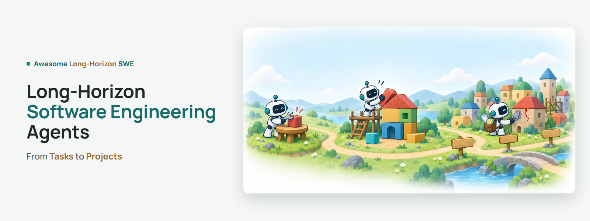</a>

  <p><strong><em>⭐ Star us if you find this useful!</em></strong></p>

  <a href="https://longhorizonswe.github.io/"></a>
  <a href="#references"></a>
  <a href="https://awesome.re"></a>

  <p>Meng&nbsp;Luo<sup>1*</sup> · Yanlin&nbsp;Li<sup>1*</sup> · Kaixin&nbsp;Li<sup>1</sup> · Yuchen&nbsp;Tian<sup>2</sup> · Shidong&nbsp;Cao<sup>2</sup> · Yanyu&nbsp;Chen<sup>3</sup> · Xiangru&nbsp;Jian<sup>4</sup> · Yan&nbsp;Yang<sup>5</sup> · Pengfei&nbsp;Zhou<sup>1</sup> · Ziyang&nbsp;Luo<sup>2</sup> · Hongzhan&nbsp;Lin<sup>1†</sup></p>
  <p><sub><sup>1</sup>&nbsp;National&nbsp;University&nbsp;of&nbsp;Singapore &nbsp;·&nbsp; <sup>2</sup>&nbsp;Hong&nbsp;Kong&nbsp;Baptist&nbsp;University &nbsp;·&nbsp; <sup>3</sup>&nbsp;The&nbsp;Chinese&nbsp;University&nbsp;of&nbsp;Hong&nbsp;Kong &nbsp;·&nbsp; <sup>4</sup>&nbsp;University&nbsp;of&nbsp;Waterloo &nbsp;·&nbsp; <sup>5</sup>&nbsp;The&nbsp;Australian&nbsp;National&nbsp;University</sub></p>
  <p><sub>* Equal contribution &nbsp;·&nbsp; † Corresponding author &nbsp;·&nbsp; <a href="mailto:mluo@u.nus.edu">mluo@u.nus.edu</a>, <a href="mailto:danielhzlin@nus.edu.sg">danielhzlin@nus.edu.sg</a></sub></p>
</div>

<picture><source media="(prefers-color-scheme: dark)" srcset="assets/readme/icons/about-dark.svg"><source media="(prefers-color-scheme: light)" srcset="assets/readme/icons/about-light.svg"></picture>

## About the survey

Software engineering agents can now navigate repositories, run tests, and resolve many real GitHub issues. Most evaluations, however, score each issue in isolation and discard the agent's patch afterward, whereas real projects accumulate: today's changes constrain tomorrow's work. This survey examines what changes when an agent must keep working on software it has already produced.

We compare evaluation protocols on two axes: who produces the state that the next request starts from, and whether behavior accepted earlier is checked again. Along these axes, we organize runtime mechanisms, training methods, and evaluation practice, propose measures of retained functionality and of conformance to active requirements, and outline open problems that center on *selective revision*: keeping useful code and knowledge while correcting what later changes invalidate.

> [!IMPORTANT]
> **What the survey finds.**
>
> - **Building on its own work is harder.** Controlled comparisons show that agents succeed markedly less often when they build on their own earlier work, and retaining the earlier conversation does not close this gap.
> - **Length alone is not continuity.** Only agent-produced chains that recheck earlier obligations can show whether an agent stays responsible for its own earlier work.
> - **Training stays within one request.** Runtime mechanisms act on state that outlives a request, yet almost all training in the reviewed work stays within a single request.
> - **Evaluation lacks a common report.** Benchmarks do not yet report cross-stage retention, recovery, and cost in a common form; retained functionality and conformance to active requirements can anchor one.

<p align="center">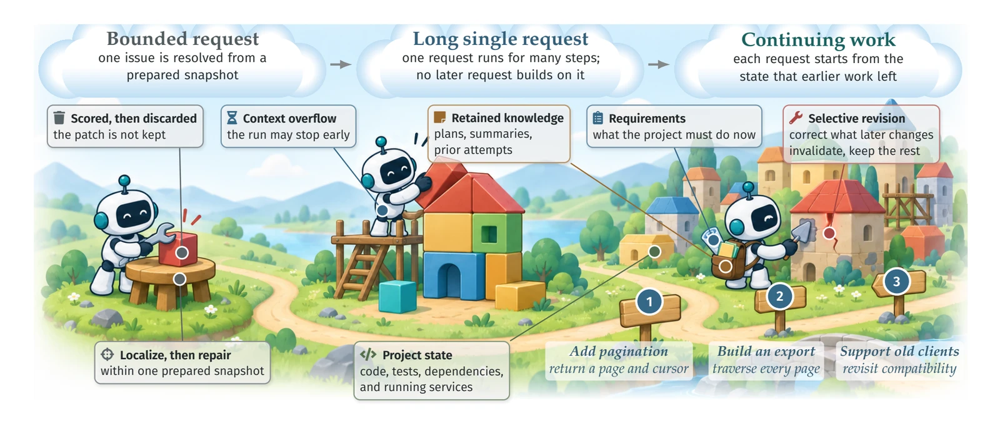</p>
<p align="center"><sub><b>Figure 1. From tasks to projects.</b> In continuing work, each request starts from the state that earlier work left; the agent works from the current requirements and brings its retained knowledge, and selective revision corrects what later changes invalidate. Signposts 1–3 are the requests of the illustrative API example used throughout.</sub></p>

<picture><source media="(prefers-color-scheme: dark)" srcset="assets/readme/icons/questions-dark.svg"><source media="(prefers-color-scheme: light)" srcset="assets/readme/icons/questions-light.svg"></picture>

## Research questions

| | Question | What it asks |
| :-: | --- | --- |
| **RQ1** | **What must persist for an agent to continue a software project?** | Which artifacts, requirements, and retained knowledge connect earlier decisions to later work, and which benchmark protocols preserve those connections? |
| **RQ2** | **How do agents preserve useful progress while revising invalidated work?** | How do context, execution, planning, verification, and learning interact, and under what conditions do memory, coordination, or feedback help? |
| **RQ3** | **How can reliable progress across changes be measured?** | How can evaluation separate local success from retained functionality, conformance to active requirements, successful recovery, operational cost, and handoff quality? |

The survey makes three contributions:

1. **A vocabulary for continuing projects** and a comparison of benchmark protocols built on it. Length alone does not make a benchmark a test of continuing work.
2. **A mapping from runtime and training mechanisms** to the persistent state they manage. Recovering knowledge and repairing inherited code turn out to be separate problems.
3. **A reporting framework** that separates retained behavior from new progress, with rates for retained functionality and for conformance to active requirements.

<p align="center">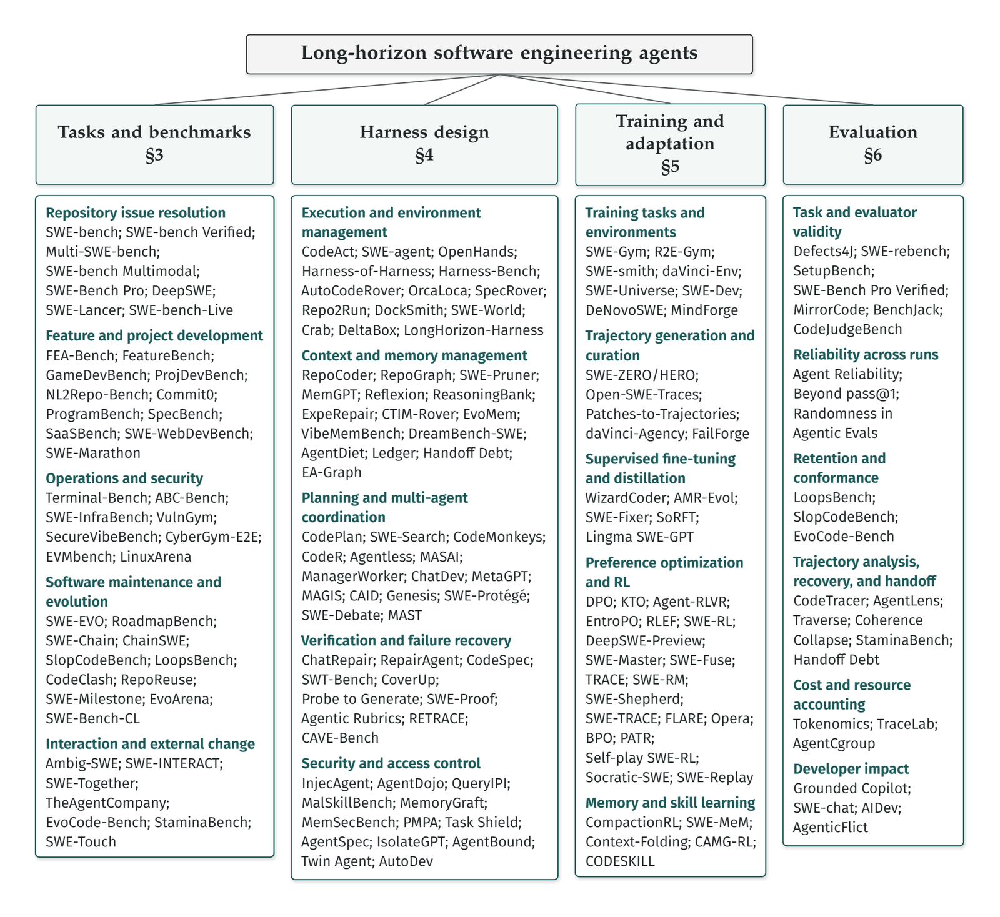</p>
<p align="center"><sub><b>Figure 2. Organization of the survey and representative works.</b> Each group within a column lists representative works discussed in the corresponding subsection.</sub></p>

<details>
<summary><b>Survey outline</b></summary>

| § | Chapter | Covers |
| :-: | --- | --- |
| 1 | **Introduction** | Motivation and scope · Research questions · Related surveys and contributions |
| 2 | **Background and Definitions** | Software engineering agents · Task length and dependencies · Project state and task formulation · From program repair to continuing projects |
| 3 | **Tasks and Benchmarks** | Repository issue resolution · Feature and project development · Operations and security · Software maintenance and evolution · Interaction and external change · Benchmark comparison and selection |
| 4 | **Harness Design** | Execution and environment management · Context and memory management · Planning and multi-agent coordination · Verification and failure recovery · Security and access control |
| 5 | **Training and Adaptation** | Training tasks and environments · Trajectory generation and curation · Supervised fine-tuning and distillation · Preference optimization and RL · Memory and skill learning |
| 6 | **Evaluation** | Task and evaluator validity · Reliability across repeated runs · Retention and conformance · Trajectory analysis, recovery, and handoff · Cost and resource accounting · Developer impact |
| 7 | **Discussion and Open Challenges** | State consistency, feedback, and revision · Design and evaluation guidance · Open challenges |
| 8 | **Conclusion** |  |
| A | **Additional Benchmark Settings** |  |

</details>

<picture><source media="(prefers-color-scheme: dark)" srcset="assets/readme/icons/guide-dark.svg"><source media="(prefers-color-scheme: light)" srcset="assets/readme/icons/guide-light.svg"></picture>

## Repository guide

<p align="center">
  <a href="#about-the-survey"><picture><source media="(prefers-color-scheme: dark)" srcset="assets/readme/card-about-dark.svg"><source media="(prefers-color-scheme: light)" srcset="assets/readme/card-about-light.svg"></picture></a>
  <a href="#research-questions"><picture><source media="(prefers-color-scheme: dark)" srcset="assets/readme/card-questions-dark.svg"><source media="(prefers-color-scheme: light)" srcset="assets/readme/card-questions-light.svg"></picture></a>
  <a href="#tasks-and-benchmarks"><picture><source media="(prefers-color-scheme: dark)" srcset="assets/readme/card-benchmarks-dark.svg"><source media="(prefers-color-scheme: light)" srcset="assets/readme/card-benchmarks-light.svg"></picture></a>
  <br>
  <a href="#harness-and-training"><picture><source media="(prefers-color-scheme: dark)" srcset="assets/readme/card-harness-dark.svg"><source media="(prefers-color-scheme: light)" srcset="assets/readme/card-harness-light.svg"></picture></a>
  <a href="#evaluation"><picture><source media="(prefers-color-scheme: dark)" srcset="assets/readme/card-evaluation-dark.svg"><source media="(prefers-color-scheme: light)" srcset="assets/readme/card-evaluation-light.svg"></picture></a>
  <a href="#open-problems"><picture><source media="(prefers-color-scheme: dark)" srcset="assets/readme/card-problems-dark.svg"><source media="(prefers-color-scheme: light)" srcset="assets/readme/card-problems-light.svg"></picture></a>
</p>

<p align="center"><a href="#from-tasks-to-projects">From tasks to projects</a> &nbsp;·&nbsp; <a href="#references">References</a> &nbsp;·&nbsp; <a href="#contributing">Contributing</a> &nbsp;·&nbsp; <a href="#contributors">Contributors</a> &nbsp;·&nbsp; <a href="#citation">Citation</a> &nbsp;·&nbsp; <a href="#star-history">Star history</a> &nbsp;·&nbsp; <a href="#repository-layout">Repository layout</a></p>

<p align="center"><sub>Survey resources: <a href="https://github.com/LongHorizonSWE/Awesome-LongHorizonSWE">Awesome-LongHorizonSWE</a> &nbsp;·&nbsp; Website: <a href="https://github.com/LongHorizonSWE/longhorizonswe.github.io">longhorizonswe.github.io</a></sub></p>

---

<picture><source media="(prefers-color-scheme: dark)" srcset="assets/readme/icons/projects-dark.svg"><source media="(prefers-color-scheme: light)" srcset="assets/readme/icons/projects-light.svg"></picture>

## From tasks to projects

Benchmarks moved from reproducible faults to repository issues and, recently, to continuing projects. What separates software engineering from long-horizon agent work in general is that the agent's code persists as the starting state of later requests, and the behavior it was accepted for can be checked again.

<p align="center">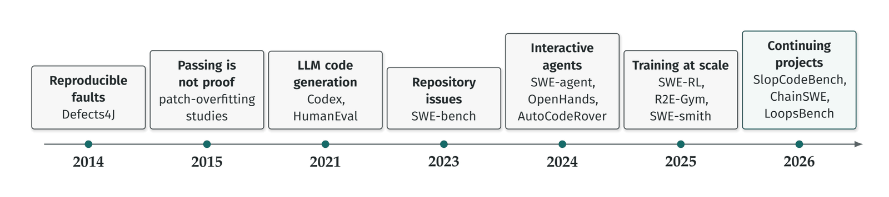</p>
<p align="center"><sub><b>Figure 5. From program repair to continuing projects.</b> Each marker gives the year in which representative work first appeared, as a preprint where one exists. Marker spacing is not proportional to time.</sub></p>

<p align="center">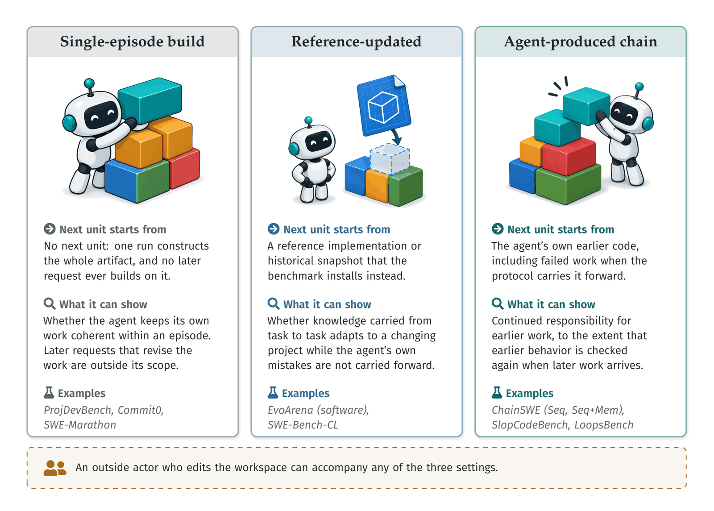</p>
<p align="center"><sub><b>Figure 3. Three settings and what each can show.</b> Each setting is defined by what the next unit starts from; Figure 8 places named protocols on both comparison axes.</sub></p>

<p align="center">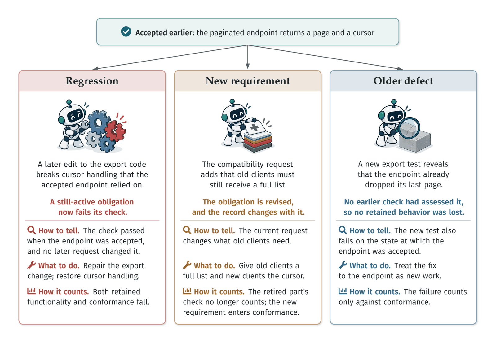</p>
<p align="center"><sub><b>Figure 4. Three events that look alike in a test report.</b> In the pagination example of Figure 1, a failing check after a later change can mark a regression, a new requirement, or an older defect. The last row shows how each event counts toward the retention and conformance measures.</sub></p>

<p align="right"><sub><a href="#repository-guide">↑ Back to guide</a></sub></p>

<picture><source media="(prefers-color-scheme: dark)" srcset="assets/readme/icons/benchmarks-dark.svg"><source media="(prefers-color-scheme: light)" srcset="assets/readme/icons/benchmarks-light.svg"></picture>

## Tasks and benchmarks

Two axes organize the comparison of benchmark protocols: **who produces the state that the next request starts from** (the agent itself, through its earlier changes, or a benchmark that prepares each snapshot or updates it with reference implementations), and **what is checked** (only the tests of the current request, or also the behavior that was accepted earlier).

<p align="center">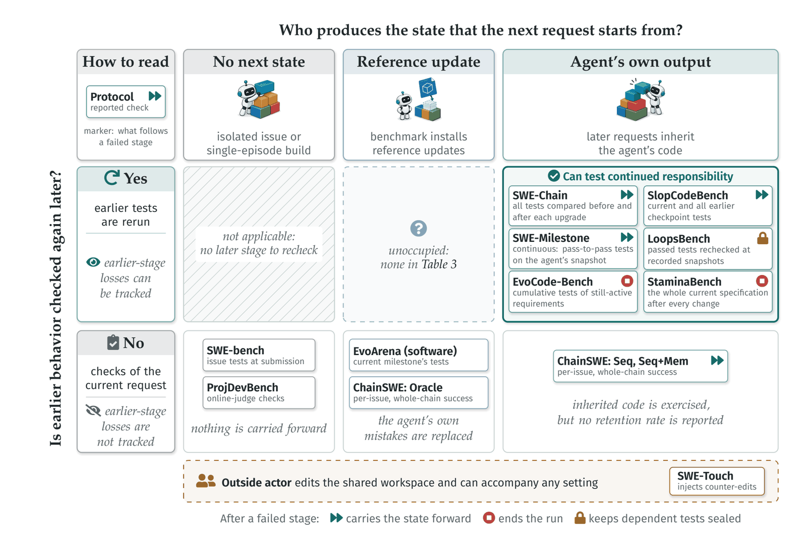</p>
<p align="center"><sub><b>Figure 8. Representative protocols on the two comparison axes.</b> Columns give who produces the state that the next request starts from, and rows give whether the tests that earlier stages of the same run passed are systematically rerun after later changes. Pass-to-pass tests fixed in advance for each issue, as in SWE-bench and ChainSWE, may cover some earlier behavior but are not such a rerun.</sub></p>

> [!NOTE]
> **Building on its own work costs accuracy.** In ChainSWE, GPT-5.5's per-issue resolution is 69.1%, 49.0%, and 47.4% when each issue starts from earlier reference fixes (Oracle), from the agent's own patches (Seq), and from its own patches plus the earlier dialogue (Seq+Mem). All 21 combinations of the seven models and three configurations that ChainSWE reports lose accuracy from Oracle to Seq, by 29% to 48% in relative terms.

<p align="center">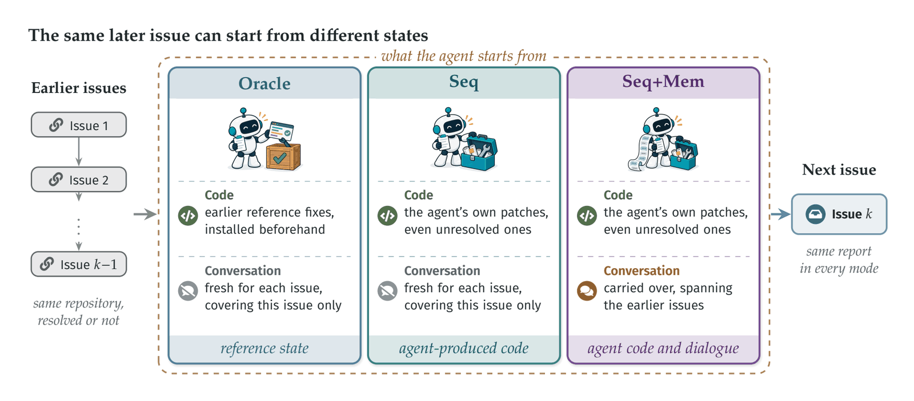</p>
<p align="center"><sub><b>Figure 6. State boundaries in sequential evaluation.</b> ChainSWE runs the same issues in three modes that differ in the code and the conversation each issue starts from; in Seq+Mem, the form of the retained dialogue depends on the context configuration (Figure 7).</sub></p>

<p align="center">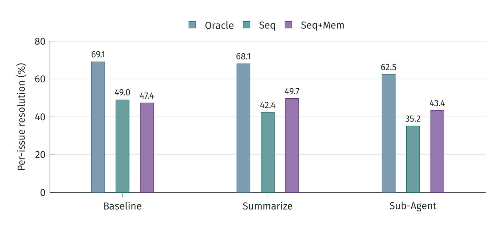</p>
<p align="center"><sub><b>Figure 7. Per-issue resolution by mode and context configuration.</b> GPT-5.5 results reported by ChainSWE on 304 issues in 100 chains under its SWE-Edit agent scaffold. Oracle installs earlier reference fixes; Seq inherits agent patches; Seq+Mem also retains dialogue. Baseline retains the full transcript; Summarize compacts older messages; Sub-Agent delegates file viewing and editing to separate contexts.</sub></p>

<p align="right"><sub><a href="#repository-guide">↑ Back to guide</a></sub></p>

<picture><source media="(prefers-color-scheme: dark)" srcset="assets/readme/icons/harness-dark.svg"><source media="(prefers-color-scheme: light)" srcset="assets/readme/icons/harness-light.svg"></picture>

## Harness and training

Each mechanism acts on a different consequence of earlier work: context and memory carry information that a later change can make obsolete, planning and coordination track dependencies that stay active across changes, execution and verification reveal when earlier work has become invalid, and learning prepares agents to recover from states shaped by prior decisions.

<p align="center">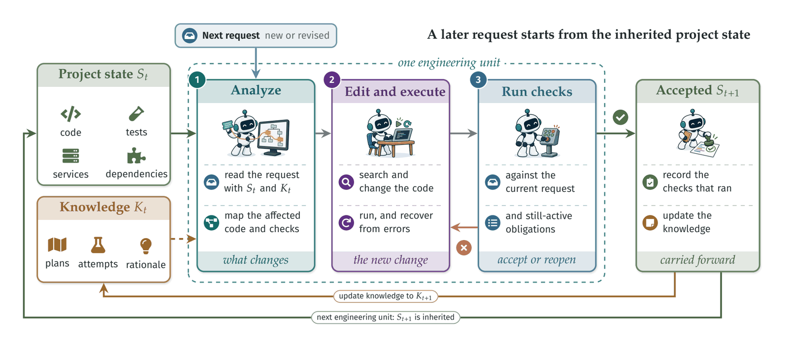</p>
<p align="center"><sub><b>Figure 10. A runtime for continuing projects.</b> The dashed link denotes knowledge supplied to analysis; failed checks reopen editing. Subscripts count closed engineering units. In many protocols a unit also closes after failed checks, and the next unit inherits that state.</sub></p>

<p align="center">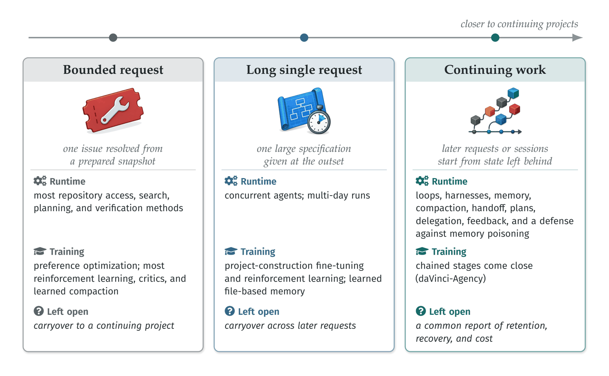</p>
<p align="center"><sub><b>Figure 9. Evaluation scopes and how far mechanisms have been tested.</b> Each runtime mechanism appears at the widest scope at which it has been evaluated, and each training method at the scope of the episodes it trains on. Most mechanisms have been tested only on bounded requests, which cannot show whether they help in a continuing project. The last row gives what remains open at each scope.</sub></p>

<p align="center">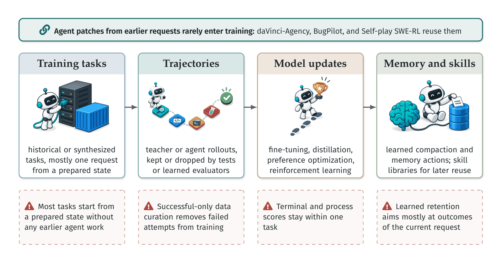</p>
<p align="center"><sub><b>Figure 11. From training data to learned behavior.</b> The pipeline that most training results follow, with the limits that keep almost all of them within a single request.</sub></p>

**Design priorities and evaluation targets by work condition.** Choose the mechanism that addresses the observed failure, and evaluate it at the boundary where the failure arises.

| Work condition | Design priority | What to measure |
| --- | --- | --- |
| **Bounded request** | Localization, execution, bounded repair | Resolved cases and complete attempt cost |
| **Long single request** | Context selection and continuation | Overflow, early stopping, information loss |
| **Continuing work** | Revision-aware retrieval, regression tests, recovery | Agent-produced chains; earlier obligations rechecked |
| **Parallel implementation** | Dependency agreement; isolation | Integration and coordination cost |
| **Interrupted work** | Checkpoint with handoff notes | Matched takeover and recovery |
| **Shared or deployed project** | Integrating outside edits; bounded authority | Edits, review, service effects |

<p align="right"><sub><a href="#repository-guide">↑ Back to guide</a></sub></p>

<picture><source media="(prefers-color-scheme: dark)" srcset="assets/readme/icons/evaluation-dark.svg"><source media="(prefers-color-scheme: light)" srcset="assets/readme/icons/evaluation-light.svg"></picture>

## Evaluation

Regression, fail-stop termination, voluntary stopping, and unsuccessful submission have different denominators and meanings, and should not be combined into one generic failure rate. The survey proposes two measures, both defined over an obligation record that the evaluator holds:

| Measure | Question | Definition |
| --- | --- | --- |
| **Retained functionality** (<i>R</i><sub>t</sub>) | Does behavior accepted earlier still work? | The share of earlier obligations, still active under the current specification and with an eligible check, whose checks all still pass at checkpoint t. |
| **Conformance to active requirements** (<i>F</i><sub>t</sub>) | Does the project now satisfy everything currently required of it? | The share of requirements the record lists as active at t, including requests the agent failed, whose checks pass at t. |

<p align="center">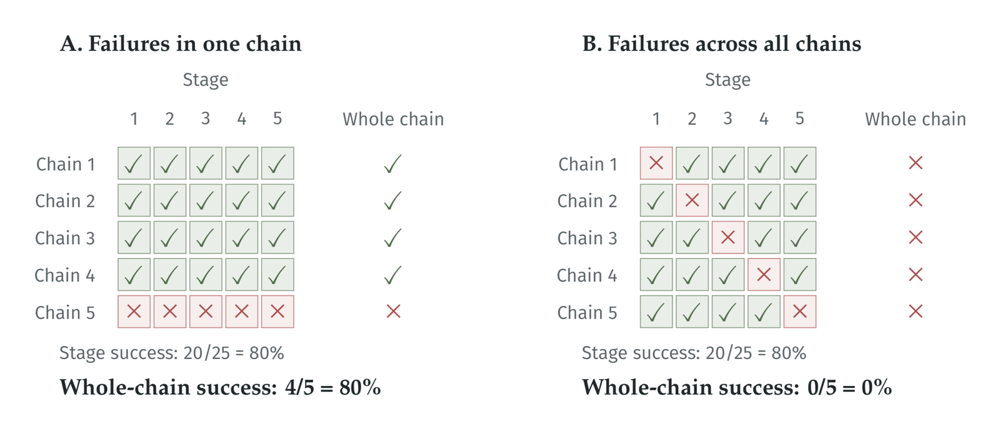</p>
<p align="center"><sub><b>Figure 12. Equal stage success can conceal different chain outcomes.</b> Each row is a constructed five-stage chain, and every stage is attempted after earlier failures. A chain counts as successful only when all five stages pass.</sub></p>

<p align="right"><sub><a href="#repository-guide">↑ Back to guide</a></sub></p>

<picture><source media="(prefers-color-scheme: dark)" srcset="assets/readme/icons/problems-dark.svg"><source media="(prefers-color-scheme: light)" srcset="assets/readme/icons/problems-light.svg"></picture>

## Open problems

The problems that no current method or benchmark solves, with what is known about each and a first experiment that could address it. Most of them return to **selective revision**: keeping useful code and knowledge while correcting what later changes invalidate.

<p align="center">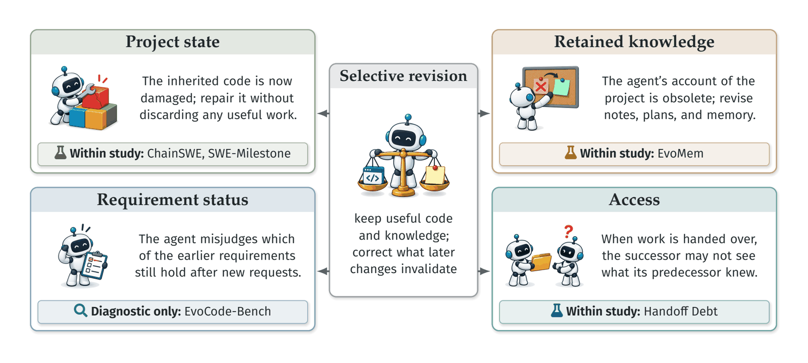</p>
<p align="center"><sub><b>Figure 13. Four ways continuing work can fail.</b> The badge in each card gives the type of study that has examined each failure.</sub></p>

| Open problem | What is known | First experiment |
| --- | --- | --- |
| **Long-term maintenance benchmarks** | | |
| Measuring retention | Per-issue and whole-chain success; earlier tests rerun; regressions inside precision scores | Declared obligation record; state saved per checkpoint; rerun validated checks of still-active obligations |
| Successor-task validity | In ChainSWE, the later problem differs between Oracle and sequential modes, as inherited code differs | Later requests classified on agent state; common predecessor states; split by earlier outcome |
| Inherited code and external change | Chain benchmarks carry the agent's own code; SWE-Touch injects outside edits in one task | Outside edits injected into an agent-produced chain |
| A common report for continuing work | Each measurement is reported by some study; definitions differ across benchmarks | One obligation split and one measurement set across several persistent protocols |
| Transfer beyond one benchmark | High scores can reflect one-benchmark adaptation; fresh task sets only partly help | One configuration held fixed across independent benchmarks and freshly reconstructed repositories |
| **Consistent revision of code and knowledge** | | |
| Selective revision | Retained dialogue gives no consistent offset for inherited code; EvoMem revises under reference updates | Hold the project change fixed; vary knowledge representation and repair actions under matched budgets |
| Requirement status | Agents can keep superseded behavior; no reviewed study isolates requirement status across requests | Fixed code and notes; vary only whether a later request retires an earlier requirement |
| Delivering experience | Most tested solver–memory pairings do not beat memory-off | Memory-off vs. revision-tagged retrieval vs. independently selected relevant records |
| Repairing compromised memory | Insertion, recall, effect, and repair are separable; repair fails mainly through collateral loss of benign memories | Poisoned-record removal; check what derived summaries and code still carry from it |
| Handoff and understanding | Context reduces rediscovery; agents can weaken comprehension relative to a chatbot | Matched takeovers with different handoff records; successor correctness and time |
| **Learning from inherited state and delayed failures** | | |
| Learning from inherited state | Chained pull-request data, gains not isolated; failed repair patches seed higher-order bugs | Training with vs. without state carryover; matched data and compute |
| Credit for delayed failures | Process signals only within one task, e.g., guiding rollouts or a trajectory-level reward | Later failures labeled as regressions, older defects, or new requirements before credit assignment |
| Recovery from damaged states | Guided retries in fresh rollouts; same-task resumption from earlier saved states | Training from settled states left by earlier failed attempts |
| **Verification coverage and reliability** | | |
| Checks for active obligations | Spec writing limits proofs; variant-guided tests strengthen oracles given a reference patch | Checks derived from accepted changes; later-regression detection |
| Validated process judges | Judges add design and process-quality information; their agreement must itself be measured | Agreement, false positives, and robustness to alternative valid solutions on long trajectories |
| **Coordination, oversight, and governance** | | |
| Coordination without shared specifications | Full specifications restore accuracy; conflict reports alone do not | Interface details omitted across parallel worktrees; detection before merge |
| Spending review and verification | Repository activity can outgrow review capacity; the benefit of running code is concentrated in some tasks | Fixed-budget check allocation to high-dependency changes; human review time reported separately |

> *Agents that revise in this way would let a team entrust a project to them and receive it back in better shape, with its history, its obligations, and the reasons behind its changes intact.*

<p align="right"><sub><a href="#repository-guide">↑ Back to guide</a></sub></p>

<picture><source media="(prefers-color-scheme: dark)" srcset="assets/readme/icons/references-dark.svg"><source media="(prefers-color-scheme: light)" srcset="assets/readme/icons/references-light.svg"></picture>

## References

439 bibliographic records cited by the survey, ordered from newest to oldest. Badges give the venue or record type. Inclusion does not imply that a work evaluates continuing projects.

| Conference | Journal | Preprint | Book | Other |
| ---: | ---: | ---: | ---: | ---: |
| 93 | 11 | 320 | 1 | 14 |

    

[2026](#year-2026) | [2025](#year-2025) | [2024](#year-2024) | [2023](#year-2023) | [2022](#year-2022) | [2021](#year-2021) | [2019](#year-2019) | [2017](#year-2017) | [2016](#year-2016) | [2015](#year-2015) | [2014](#year-2014) | [2013](#year-2013) | [2012](#year-2012) | [2011](#year-2011) | [2006](#year-2006) | [2005](#year-2005) | [2000](#year-2000) | [1998](#year-1998) | [1996](#year-1996) | [1994](#year-1994) | [1992](#year-1992) | [1980](#year-1980)

<a id="year-2026"></a>

### 2026

- "AI Slop is DDoSing Open Source": Understanding the Impact of AI-Generated Contributions on Open Source Sustainability. [[paper](<https://arxiv.org/abs/2607.04003v1>)] 
- "Do Not Mention This to the User": Detecting and Understanding Malicious Agent Skills in the Wild. [[paper](<https://arxiv.org/abs/2602.06547v4>)] 
- “You're Right, Let Me Fix It”: How LLM Agents Damage Correct Work When Falsely Accused. [[paper](<https://arxiv.org/abs/2609.32616v1>)] 
- (Im)Paired Programming: Coding Agents Improve Productivity but Harm Understanding. [[paper](<https://arxiv.org/abs/2607.26375v1>)] 
- A Rubric-Supervised Critic from Sparse Real-World Outcomes. [[paper](<https://arxiv.org/abs/2603.03800v1>)] 
- A Survey of Agent Memory in the Second Half: Towards Self-Evolving and Long-Horizon Agents. [[paper](<https://arxiv.org/abs/2602.06052v1>)] 
- ABC-Bench: Benchmarking Agentic Backend Coding in Real-World Development. [[paper](<https://arxiv.org/abs/2601.11077v1>)] 
- Accelerating the Adoption of Software and Artificial Intelligence Agent Identity and Authorization. [[paper](<https://csrc.nist.gov/pubs/other/2026/02/05/accelerating-the-adoption-of-software-and-ai-agent/ipd>)] 
- ACRFence: Preventing Semantic Rollback Attacks in Agent Checkpoint-Restore. [[paper](<https://arxiv.org/abs/2603.20625v1>)] 
- Adoption and Impact of Command-Line AI Coding Agents: A Study of Microsoft's Early 2026 Rollout of Claude Code and GitHub Copilot CLI. [[paper](<https://arxiv.org/abs/2607.01418v1>)] 
- Advances and Frontiers of LLM-based Issue Resolution in Software Engineering: A Comprehensive Survey. [[paper](<https://arxiv.org/abs/2601.11655v1>)] 
- AgencyBench: Benchmarking the Frontiers of Autonomous Agents in 1M-Token Real-World Contexts. [[paper](<https://arxiv.org/abs/2601.11044v4>)] 
- AgentBound: Securing Execution Boundaries of AI Agents. [[paper](<https://doi.org/10.1145/3808103>)] 
- AgentCgroup: Understanding and Controlling OS Resources of AI Agents. [[paper](<https://arxiv.org/abs/2602.09345v3>)] 
- Agentic Code Reasoning. [[paper](<https://arxiv.org/abs/2603.01896v1>)] 
- Agentic Context Engineering: Evolving Contexts for Self-Improving Language Models. [[paper](<https://arxiv.org/abs/2510.04618v3>)] 
- Agentic Harness Engineering: Observability-Driven Automatic Evolution of Coding-Agent Harnesses. [[paper](<https://arxiv.org/abs/2604.25850>)] 
- Agentic Rubrics as Contextual Verifiers for SWE Agents. [[paper](<https://arxiv.org/abs/2601.04171v1>)] 
- Agentic Uncertainty Reveals Agentic Overconfidence. [[paper](<https://arxiv.org/abs/2602.06948v1>)] 
- AgenticFlict: A Large-Scale Dataset of Merge Conflicts in AI Coding Agent Pull Requests on GitHub. [[paper](<https://arxiv.org/abs/2604.03551v2>)] 
- AgentLens: Revealing The Lucky Pass Problem in SWE-Agent Evaluation. [[paper](<https://arxiv.org/abs/2605.12925v3>)] 
- AgentRewind: Recoverable Execution for Long-Horizon LLM Agents. [[paper](<https://arxiv.org/abs/2608.14380v1>)] 
- AgentSpawn: Adaptive Multi-Agent Collaboration Through Dynamic Spawning for Long-Horizon Code Generation. [[paper](<https://arxiv.org/abs/2602.07072>)] 
- AgentSpec: Customizable Runtime Enforcement for Safe and Reliable LLM Agents. [[paper](<https://arxiv.org/abs/2503.18666v3>)] 
- Agyn: A Multi-Agent System for Team-Based Autonomous Software Engineering. [[paper](<https://arxiv.org/abs/2602.01465v2>)] 
- AI Agent Pull Requests on GitHub: Frequency, Structure, and Merge Conflict Rates. [[paper](<https://arxiv.org/abs/2607.04697>)] 
- AI for Games in the Foundation Model Era. [[paper](<https://arxiv.org/abs/2609.16679>)] 
- AI IDEs or Autonomous Agents? Measuring the Impact of Coding Agents on Software Development. [[paper](<https://arxiv.org/abs/2601.13597>)] 
- AI Writes Faster Than Humans Can Review: A Longitudinal Study of an Enterprise 2x Mandate. [[paper](<https://arxiv.org/abs/2607.01904v1>)] 
- AIDev: Studying AI Coding Agents on GitHub. [[paper](<https://arxiv.org/abs/2602.09185v1>)] 
- Always-On Agents: A Survey of Persistent Memory, State, and Governance in LLM Agents. [[paper](<https://arxiv.org/abs/2606.30306v1>)] 
- Ambig-SWE: Interactive Agents to Overcome Underspecificity in Software Engineering. [[paper](<https://arxiv.org/abs/2502.13069v3>)] 
- An Empirical Study of Harness Design for Coding Agents. [[paper](<https://arxiv.org/abs/2609.20804v1>)] 
- Are "Solved Issues" in SWE-bench Really Solved Correctly? An Empirical Study. [[paper](<https://arxiv.org/abs/2503.15223v2>)] 
- Are AI-assisted Development Tools Immune to Prompt Injection? [[paper](<https://arxiv.org/abs/2603.21642v1>)] 
- AutoCompact: Learning When to Compact Context in Long-Horizon Coding Agents. [[paper](<https://arxiv.org/abs/2610.02163>)] 
- Benchmarking the Residual: What Long-Horizon Evaluations Add Beyond Matched Short-Task Performance. [[paper](<https://arxiv.org/abs/2607.27283v1>)] 
- Beyond Isolated Tasks: A Framework for Evaluating Coding Agents on Sequential Software Evolution. [[paper](<https://arxiv.org/abs/2604.03035v1>)] 
- Beyond pass@1: A Reliability Science Framework for Long-Horizon LLM Agents. [[paper](<https://arxiv.org/abs/2603.29231v1>)] 
- Beyond the Payload: How User Invocation Shapes Coding Agent Vulnerability to Repository Poisoning. [[paper](<https://arxiv.org/abs/2608.30686>)] 
- Beyond Token Savings: A Systematic Study of Context Compression in LLM Agents. [[paper](<https://arxiv.org/abs/2609.32961v1>)] 
- Branching Policy Optimization: Sandbox-Native Language Agent Reinforcement Learning. [[paper](<https://arxiv.org/abs/2607.14171v1>)] 
- Breaking, Stale, or Missing? Benchmarking Coding Agents on Project-Level Test Evolution. [[paper](<https://arxiv.org/abs/2605.06125>)] 
- Can AI Models Direct Each Other? Organizational Structure as a Probe into Training Limitations. [[paper](<https://arxiv.org/abs/2603.26458v1>)] 
- ChainSWE: Benchmarking Coding Agents on Multi-Bug Software Maintenance. [[paper](<https://arxiv.org/abs/2607.02606v2>)] 
- CODESKILL: Learning Self-Evolving Skills for Coding Agents. [[paper](<https://arxiv.org/abs/2605.25430v1>)] 
- CodeSpec: Dual Executable Specifications for Agentic Long-Horizon Feature Development. [[paper](<https://arxiv.org/abs/2607.26777v1>)] 
- CodeTracer: Towards Traceable Agent States. [[paper](<https://arxiv.org/abs/2604.11641v3>)] 
- Codified Context: Infrastructure for AI Agents in a Complex Codebase. [[paper](<https://arxiv.org/abs/2602.20478>)] 
- Coding Agent Memory Post-training: Unlocking the Memory Potential of Pre-trained File Operations for Long-Horizon Tasks via Reinforcement Learning. [[paper](<https://arxiv.org/abs/2609.34422v2>)] 
- Coherence Collapse: Diagnosing Why Code Agents Fail After Reaching the Right Code. [[paper](<https://arxiv.org/abs/2603.24631v2>)] 
- Compact-Bench: Measuring What Context Compaction Costs Long-Horizon Coding Agents. [[paper](<https://arxiv.org/abs/2610.31710>)] 
- CompactionRL: Reinforcement Learning with Context Compaction for Long-Horizon Agents. [[paper](<https://arxiv.org/abs/2607.05378v1>)] 
- Continual Learning Bench: Evaluating Frontier AI Systems in Real-World Stateful Environments. [[paper](<https://arxiv.org/abs/2606.05661>)] 
- Continually improving our agent harness. [[paper](<https://cursor.com/blog/continually-improving-agent-harness>)] 
- CooperBench: Why Coding Agents Cannot be Your Teammates Yet. [[paper](<https://arxiv.org/abs/2601.13295v1>)] 
- CORVUS: Context Optimization and Reduction Via Underlying Synchronization for LLM Coding Agents. [[paper](<https://arxiv.org/abs/2607.22711>)] 
- Crab: A Semantics-Aware Checkpoint/Restore Runtime for Agent Sandboxes. [[paper](<https://arxiv.org/abs/2604.28138v1>)] 
- CyberGym-E2E: Scalable Real-World Benchmark for AI Agents' End-to-End Cybersecurity Capabilities. [[paper](<https://arxiv.org/abs/2606.04460v2>)] 
- daVinci-Agency: Unlocking Long-Horizon Agency Data-Efficiently. [[paper](<https://arxiv.org/abs/2602.02619v2>)] 
- daVinci-Env: Open SWE Environment Synthesis at Scale. [[paper](<https://arxiv.org/abs/2603.13023v2>)] 
- Debt Behind the AI Boom: A Large-Scale Empirical Study of AI-Generated Code in the Wild. [[paper](<https://arxiv.org/abs/2603.28592>)] 
- DeepSWE: Measuring Frontier Coding Agents on Original, Long-Horizon Engineering Tasks. [[paper](<https://arxiv.org/abs/2607.07946v1>)] 
- DeltaBox: Scaling Stateful AI Agents with Millisecond-Level Sandbox Checkpoint/Rollback. [[paper](<https://arxiv.org/abs/2605.22781v2>)] 
- DeNovoSWE: Scaling Long-Horizon Environments for Generating Entire Repositories from Scratch. [[paper](<https://arxiv.org/abs/2606.10728v2>)] 
- Detecting Malicious Agent Skills in the Wild using Attention. [[paper](<https://arxiv.org/abs/2606.23416v1>)] 
- Dialectical Structured Reasoning for Explainable Multimodal Fake News Detection. [[paper](<https://aclanthology.org/2026.findings-acl.1601/>)] 
- DiffCoT: Diffusion-styled Chain-of-Thought Reasoning in LLMs. [[paper](<https://aclanthology.org/2026.findings-acl.1939/>)] 
- Dive into Claude Code: The Design Space of Today's and Future AI Agent Systems. [[paper](<https://arxiv.org/abs/2604.14228v2>)] 
- Do Androids Dream of Breaking the Game? Systematically Auditing AI Agent Benchmarks with BenchJack. [[paper](<https://arxiv.org/abs/2605.12673v1>)] 
- Do Coding Agents Reuse Existing Code or Reinvent the Wheel? [[paper](<https://arxiv.org/abs/2609.35357v1>)] 
- Do Modifications Made by Coding Agents Make Subsequent Software Maintenance Harder? [[paper](<https://arxiv.org/abs/2610.14768>)] 
- DockSmith: Scaling Reliable Coding Environments via an Agentic Docker Builder. [[paper](<https://arxiv.org/abs/2602.00592v2>)] 
- Don't Blame the Large Language Model: How Agent Harness Evolution Shapes Coding Agent Quality. [[paper](<https://arxiv.org/abs/2607.03691>)] 
- Don't Let AI Agents YOLO Your Files: Information and Control in Agent-Native Filesystems. [[paper](<https://arxiv.org/abs/2604.13536>)] 
- DreamBench-SWE: A Multi-Session Memory-Hygiene Benchmark for Software Agents. [[paper](<https://arxiv.org/abs/2608.20664v1>)] 
- EA-Graph: Artifact-Anchored Verification Memory for Coding Agents under Upstream Drift. [[paper](<https://arxiv.org/abs/2608.04278v1>)] 
- Effective Strategies for Asynchronous Software Engineering Agents. [[paper](<https://arxiv.org/abs/2603.21489v2>)] 
- Evaluating AGENTS.md: Are Repository-Level Context Files Helpful for Coding Agents? [[paper](<https://arxiv.org/abs/2602.11988v1>)] 
- EVMbench: Evaluating AI Agents on Smart Contract Security. [[paper](<https://arxiv.org/abs/2603.04915v1>)] 
- EvoArena: Tracking Memory Evolution for Robust LLM Agents in Dynamic Environments. [[paper](<https://arxiv.org/abs/2606.13681v2>)] 
- EvoCode-Bench: Evaluating Coding Agents in Multi-Turn Iterative Interactions. [[paper](<https://arxiv.org/abs/2605.24110v1>)] 
- EVOMAL: Self-Poisoning in Self-Evolving Coding Agents. [[paper](<https://arxiv.org/abs/2608.25776v1>)] 
- EvoWeb: A Benchmark for Coding Agents on Evolving Web Applications. [[paper](<https://arxiv.org/abs/2610.16402>)] 
- ExpeRepair: Dual-Memory Enhanced LLM-Based Repository-Level Program Repair. [[paper](<https://arxiv.org/abs/2506.10484v2>)] 
- ExplainHM++: Explainable Harmful Meme Detection With Retrieval-Augmented Debate Between Large Multimodal Models. [[paper](<https://doi.org/10.1109/TKDE.2025.3637552>)] 
- FailForge: Distilling Procedural Competence from Persistent Failures into Code Agents. [[paper](<https://arxiv.org/abs/2608.08570v1>)] 
- FeatureArc: Benchmarking Coding Agents on Evolving Features. [[paper](<https://arxiv.org/abs/2610.37434>)] 
- FeatureBench: Benchmarking Agentic Coding for Complex Feature Development. [[paper](<https://openreview.net/forum?id=41xrZ3uGuI>)] 
- Fixing Security Vulnerabilities with Agentic AI in OSS-Fuzz. [[paper](<https://doi.org/10.1145/3786583.3786880>)] 
- FLARE: A Full-Lifecycle Dense Supervision Paradigm for Long-Horizon Coding Agents via Generative Reward Model. [[paper](<https://arxiv.org/abs/2609.23808v1>)] 
- From Evidence to Action: How Tool-Using Agents Fail. [[paper](<https://arxiv.org/abs/2610.07753v1>)] 
- From Industry Claims to Empirical Reality: An Empirical Study of Code Review Agents in Pull Requests. [[paper](<https://arxiv.org/abs/2604.03196>)] 
- From Patches to Trajectories: Privileged Process Supervision for Software-Engineering Agents. [[paper](<https://arxiv.org/abs/2605.21996v1>)] 
- From Question Answering to Task Completion: A Survey on Agent System and Harness Design. [[paper](<https://arxiv.org/abs/2606.20683v1>)] 
- From Storage to Experience: A Survey on the Evolution of LLM Agent Memory Mechanisms. [[paper](<https://arxiv.org/abs/2605.06716v1>)] 
- From SWE-ZERO to SWE-HERO: Execution-free to Execution-based Fine-tuning for Software Engineering Agents. [[paper](<https://arxiv.org/abs/2604.01496v2>)] 
- GameDevBench: Evaluating Agentic Capabilities Through Game Development. [[paper](<https://arxiv.org/abs/2602.11103v2>)] 
- GitHub Copilot and Developer Productivity: An Observational Dose-Response Analysis. [[paper](<https://arxiv.org/abs/2606.00438v1>)] 
- GitInject: Real-World Prompt Injection Attacks in AI-Powered CI/CD Pipelines. [[paper](<https://arxiv.org/abs/2606.09935>)] 
- Guardrails Beat Guidance: A Large-Scale Study of Rules, Skills, and Persistent Configuration for Coding Agents. [[paper](<https://arxiv.org/abs/2604.11088v2>)] 
- Habituation at the Gate: Rising Approval and Declining Scrutiny in Human Review of AI Agent Code. [[paper](<https://arxiv.org/abs/2606.22721v1>)] 
- Handoff Debt: The Rediscovery Cost When Coding Agents Take Over Interrupted Tasks. [[paper](<https://arxiv.org/abs/2606.02875v2>)] 
- Harness design for long-running application development. [[paper](<https://www.anthropic.com/engineering/harness-design-long-running-apps>)] 
- Harness Engineering: Anatomy, Architecture, and Evolution of Coding Agents – A Source-Code Study of Eleven Systems. [[paper](<https://arxiv.org/abs/2609.00006v1>)] 
- Harness engineering: leveraging Codex in an agent-first world. [[paper](<https://openai.com/index/harness-engineering/>)] 
- Harness-Bench: Evaluating Agent Harnesses across Models and Realistic Workflows. [[paper](<https://arxiv.org/abs/2605.27922v2>)] 
- Harness-of-Harness: Multi-Day Autonomous Software Development with Continual Improvement. [[paper](<https://arxiv.org/abs/2609.01481v1>)] 
- How Agents Ask for Permission: User Permissions for AI Agents, from Interfaces to Enforcement. [[paper](<https://arxiv.org/abs/2607.13718v2>)] 
- How Coding Agents Fail Their Users: A Large-Scale Analysis of Developer-Agent Misalignment in 20,574 Real-World Sessions. [[paper](<https://arxiv.org/abs/2605.29442v1>)] 
- How Do AI Agents Spend Your Money? Analyzing and Predicting Token Consumption in Agentic Coding Tasks. [[paper](<https://arxiv.org/abs/2604.22750v2>)] 
- Humans are Missing from AI Coding Agent Research. [[paper](<https://arxiv.org/abs/2608.12355v1>)] 
- ICAE-Bench: Evaluating Coding Agents as Interactive Project Builders. [[paper](<https://arxiv.org/abs/2607.21217>)] 
- Impact Is Not Invalidation: Ask About the Claim, Not the Diff. [[paper](<https://arxiv.org/abs/2609.25130v1>)] 
- Improving Code Localization with Repository Memory. [[paper](<https://arxiv.org/abs/2510.01003v2>)] 
- Independent Patch Verification for Coding Agents with a Bidirectional Reconstruct-and-Verify Framework. [[paper](<https://arxiv.org/abs/2608.08950v1>)] 
- Inside the Scaffold: A Source-Code Taxonomy of Coding Agent Architectures. [[paper](<https://arxiv.org/abs/2604.03515v2>)] 
- Investigating Autonomous Agent Contributions in the Wild: Activity Patterns and Code Change over Time. [[paper](<https://arxiv.org/abs/2604.00917>)] 
- Investigating Test Overfitting on SWE-bench. [[paper](<https://doi.org/10.1145/3803437.3805574>)] 
- Learning to Commit: Generating Organic Pull Requests via Online Repository Memory. [[paper](<https://arxiv.org/abs/2603.26664v1>)] 
- LEGO-RL: Harness-Native Reinforcement Learning for Coding Agents. [[paper](<https://arxiv.org/abs/2608.17393v1>)] 
- LinuxArena: A Control Setting for AI Agents in Live Production Software Environments. [[paper](<https://arxiv.org/abs/2604.15384v2>)] 
- Locating Hidden Failures Makes Long-Horizon Agents More Reliable. [[paper](<https://arxiv.org/abs/2609.17930v1>)] 
- Long-Horizon-Terminal-Bench: Testing the Limits of Agents on Long-Horizon Terminal Tasks with Dense Reward-Based Grading. [[paper](<https://arxiv.org/abs/2607.08964>)] 
- LongHorizon-Harness: Advancing Long-Horizon Agents for Real-World Tasks. [[paper](<https://arxiv.org/abs/2608.01964v1>)] 
- LoopsBench: From Harness Engineering to Loop Engineering in Coding Agent Evaluation. [[paper](<https://arxiv.org/abs/2608.00267v2>)] 
- MalSkillBench: A Runtime-Verified Benchmark of Malicious Agent Skills. [[paper](<https://arxiv.org/abs/2606.07131v3>)] 
- Many SWE-bench-Passing PRs Would Not Be Merged into Main. [[paper](<https://metr.org/notes/2026-03-10-many-swe-bench-passing-prs-would-not-be-merged-into-main/>)] 
- MemDev-Bench: Does Memory Help Code Agents? Benchmarking Memory Systems over Real Repository Histories. [[paper](<https://arxiv.org/abs/2610.27524>)] 
- MemSecBench: Tracking Agent Memory Poisoning from Persistence to Consequence and Repair. [[paper](<https://arxiv.org/abs/2607.27080v1>)] 
- MindForge: Teaching Small Language Models Whole-Life-Cycle Software Engineering via Source-Free Program Synthesis. [[paper](<https://arxiv.org/abs/2607.27146v1>)] 
- MirrorCode: AI can rebuild entire programs from behavior alone. [[paper](<https://arxiv.org/abs/2606.30182v2>)] 
- Model Context Protocol Threat Modeling and Analyzing Vulnerabilities to Prompt Injection with Tool Poisoning. [[paper](<https://arxiv.org/abs/2603.22489v1>)] 
- Multi-agent Collaboration with State Management. [[paper](<https://arxiv.org/abs/2605.20563v1>)] 
- Not All Agents Are Equal: Code Quality and Post-Merge Maintenance Across Five Autonomous Coding Agents in the Wild. [[paper](<https://arxiv.org/abs/2609.17598v1>)] 
- OmniCode: A Benchmark for Evaluating Software Engineering Agents. [[paper](<https://arxiv.org/abs/2602.02262>)] 
- On Problems of Implicit Context Compression for Software Engineering Agents. [[paper](<https://arxiv.org/abs/2605.11051>)] 
- On Randomness in Agentic Evals. [[paper](<https://arxiv.org/abs/2602.07150v1>)] 
- Open-SWE-Traces: Advancing Dual-Mode Multilingual Distillation for Software Engineering Agents. [[paper](<https://arxiv.org/abs/2606.16038v1>)] 
- Opera: A Verbal Critic Framework for Long-horizon Coding Agents. [[paper](<https://arxiv.org/abs/2609.33987v1>)] 
- Persistent Recursive Worlds Enable Autonomous Software Evolution. [[paper](<https://arxiv.org/abs/2608.10450v3>)] 
- Position: Coding Benchmarks Are Misaligned with Agentic Software Engineering. [[paper](<https://arxiv.org/abs/2606.17799v2>)] 
- Probe to Generate: Program Variant-Guided Test Augmentation for Repository-Level Repair Benchmarks. [[paper](<https://arxiv.org/abs/2604.01518v2>)] 
- Process Reward Informed Tree Rollout for Effective Multi-Turn RL. [[paper](<https://arxiv.org/abs/2607.15610v1>)] 
- ProductWebBench: Evaluating Website Continuity Beyond Task Completion. [[paper](<https://arxiv.org/abs/2610.31118>)] 
- ProgramBench: Can Language Models Rebuild Programs From Scratch? [[paper](<https://arxiv.org/abs/2605.03546v1>)] 
- ProjDevBench: Benchmarking AI Coding Agents on End-to-End Project Development. [[paper](<https://arxiv.org/abs/2602.01655v2>)] 
- Quantifying Frontier LLM Capabilities for Container Sandbox Escape. [[paper](<https://arxiv.org/abs/2603.02277v3>)] 
- QwenGyre: An Elastic Reinforcement Learning Framework for Training xLong-Horizon Agents. [[paper](<https://arxiv.org/abs/2609.33848v1>)] 
- ReasoningBank: Scaling Agent Self-Evolving with Reasoning Memory. [[paper](<https://arxiv.org/abs/2509.25140v2>)] 
- Reducing Cost of LLM Agents with Trajectory Reduction. [[paper](<https://arxiv.org/abs/2509.23586v2>)] 
- RepoFuse: A Dual-Context Approach to Repository-Level Code Completion at Industrial Scale. [[paper](<https://doi.org/10.1145/3803437.3805230>)] 
- RepoZero: Can LLMs Generate a Code Repository from Scratch? [[paper](<https://arxiv.org/abs/2605.07122>)] 
- Rethinking the Value of Agent-Generated Tests for LLM-Based Software Engineering Agents. [[paper](<https://arxiv.org/abs/2602.07900>)] 
- RoadmapBench: Evaluating Long-Horizon Agentic Software Development Across Version Upgrades. [[paper](<https://arxiv.org/abs/2605.15846v2>)] 
- Run long horizon tasks with Codex. [[paper](<https://developers.openai.com/blog/run-long-horizon-tasks-with-codex>)] 
- SaaSBench: Exploring the Boundaries of Coding Agents in Long-Horizon Enterprise SaaS Engineering. [[paper](<https://arxiv.org/abs/2605.17526v1>)] 
- SABER: Benchmarking Operational Safety of LLM Coding Agents in Stateful Project Workspaces. [[paper](<https://arxiv.org/abs/2606.01317>)] 
- Safe to Resume? Breaking Execution Continuity of Agent Execution via Rollback. [[paper](<https://arxiv.org/abs/2608.29381>)] 
- Same Signal, Different Semantics: A Cross-Framework Behavioral Analysis of Software Engineering Agents. [[paper](<https://arxiv.org/abs/2605.18332>)] 
- SecureVibeBench: Benchmarking Secure Vibe Coding of AI Agents via Reconstructing Vulnerability-Introducing Scenarios. [[paper](<https://arxiv.org/abs/2509.22097v5>)] 
- Self-Evolving Coding Agents. [[paper](<https://arxiv.org/abs/2608.03392v4>)] 
- Silent Egress: When Implicit Prompt Injection Makes LLM Agents Leak Without a Trace. [[paper](<https://arxiv.org/abs/2602.22450v1>)] 
- SkillForge: Self-Distilling Agents for Project-Specific Issue Resolution. [[paper](<https://arxiv.org/abs/2608.18933>)] 
- SkillsBench: Benchmarking How Well Agent Skills Work Across Diverse Tasks. [[paper](<https://arxiv.org/abs/2602.12670>)] 
- SlopCodeBench: Benchmarking How Coding Agents Degrade Over Long-Horizon Iterative Tasks. [[paper](<https://arxiv.org/abs/2603.24755v2>)] 
- Socratic-SWE: Self-Evolving Coding Agents via Trace-Derived Agent Skills. [[paper](<https://arxiv.org/abs/2606.07412v1>)] 
- SpecBench: Measuring Reward Hacking in Long-Horizon Coding Agents. [[paper](<https://arxiv.org/abs/2605.21384v2>)] 
- SPROUT: Scaling Agentic Reinforcement Learning for Long-Horizon Software Engineering. [[paper](<https://arxiv.org/abs/2610.14405v1>)] 
- StaminaBench: Stress-Testing Coding Agents over 100 Interaction Turns. [[paper](<https://arxiv.org/abs/2606.19613v1>)] 
- Steer, Don't Solve: Training Small Critic Models for Large Code Agents. [[paper](<https://arxiv.org/abs/2606.21811v2>)] 
- Structurally Aligned Subtask-Level Memory for Software Engineering Agents. [[paper](<https://arxiv.org/abs/2602.21611>)] 
- SWE Context Bench: A Benchmark for Context Learning in Coding. [[paper](<https://arxiv.org/abs/2602.08316>)] 
- SWE Refactor Bench: Can Coding Agents Complete a Long-Horizon, Whole-Repository Stack Migration? [[paper](<https://arxiv.org/abs/2608.23564v1>)] 
- SWE-ABS: Adversarial Benchmark Strengthening Exposes Inflated Success Rates on Test-based Benchmark. [[paper](<https://arxiv.org/abs/2603.00520>)] 
- SWE-Bench Pro Verified: A Reliable Benchmark for Software Engineering Agents. [[paper](<https://arxiv.org/abs/2609.08149v2>)] 
- SWE-Chain: Benchmarking Coding Agents on Chained Release-Level Package Upgrades. [[paper](<https://arxiv.org/abs/2605.14415v1>)] 
- SWE-chat: Coding Agent Interactions From Real Users in the Wild. [[paper](<https://arxiv.org/abs/2604.20779v1>)] 
- SWE-CI: Evaluating Agent Capabilities in Maintaining Codebases via Continuous Integration. [[paper](<https://arxiv.org/abs/2603.03823v1>)] 
- SWE-Doctor: Guiding Software Engineering Agents with Runtime Diagnosis from Multi-Faceted Bug Reproduction Tests. [[paper](<https://arxiv.org/abs/2607.00990>)] 
- SWE-Fuse: Empowering Software Agents via Issue-free Trajectory Learning and Entropy-aware RLVR Training. [[paper](<https://arxiv.org/abs/2603.07927v1>)] 
- SWE-InfraBench: Evaluating Language Models on Cloud Infrastructure Code. [[paper](<https://arxiv.org/abs/2606.05249v1>)] 
- SWE-INTERACT: Reimagining SWE Benchmarks as User-Driven Long-Horizon Coding Sessions. [[paper](<https://arxiv.org/abs/2606.30573v1>)] 
- SWE-Lego: Pushing the Limits of Supervised Fine-tuning for Software Issue Resolving. [[paper](<https://arxiv.org/abs/2601.01426>)] 
- SWE-Marathon: Can Agents Autonomously Complete Ultra-Long-Horizon Software Work? [[paper](<https://arxiv.org/abs/2606.07682v1>)] 
- SWE-Master: Unleashing the Potential of Software Engineering Agents via Post-Training. [[paper](<https://arxiv.org/abs/2602.03411v2>)] 
- SWE-MeM: Learning Adaptive Memory Management for Long-Horizon Coding Agents. [[paper](<https://arxiv.org/abs/2606.28434v1>)] 
- SWE-MILE: Asynchronous Potential-Induced Milestone Credit Assignment for Long-Horizon Software Engineering Agents. [[paper](<https://arxiv.org/abs/2609.32631>)] 
- SWE-Milestone: Evaluating AI Agents on Continuous Software Evolution. [[paper](<https://arxiv.org/abs/2603.13428v4>)] 
- SWE-NFI: Studying and Benchmarking Coding Agents for Non-Functional Improvements. [[paper](<https://arxiv.org/abs/2607.27409>)] 
- SWE-Proof: Can Language Models Resolve Real-World Issues with Machine-Checked Proofs? [[paper](<https://arxiv.org/abs/2609.21190v1>)] 
- SWE-Protégé: Learning to Selectively Collaborate With an Expert Unlocks Small Language Models as Software Engineering Agents. [[paper](<https://arxiv.org/abs/2602.22124v1>)] 
- SWE-Pruner: Self-Adaptive Context Pruning for Coding Agents. [[paper](<https://arxiv.org/abs/2601.16746v4>)] 
- SWE-rebench V2: Language-Agnostic SWE Task Collection at Scale. [[paper](<https://arxiv.org/abs/2602.23866>)] 
- SWE-Replay: Efficient Test-Time Scaling for Software Engineering Agents. [[paper](<https://arxiv.org/abs/2601.22129v2>)] 
- SWE-Residual: Evaluating Starting-State Robustness of Coding Agents. [[paper](<https://arxiv.org/abs/2610.25899>)] 
- SWE-Shepherd: Advancing PRMs for Reinforcing Code Agents. [[paper](<https://arxiv.org/abs/2604.10493v1>)] 
- SWE-Shift: Evaluating Coding Agents in Evolving Workspaces. [[paper](<https://arxiv.org/abs/2610.32196>)] 
- SWE-Together: Evaluating Coding Agents in Interactive User Sessions. [[paper](<https://arxiv.org/abs/2606.29957v1>)] 
- SWE-Touch: Benchmarking Coding Agents When Users Touch the Code. [[paper](<https://arxiv.org/abs/2608.02499v1>)] 
- SWE-TRACE: Optimizing Long-Horizon SWE Agents Through Rubric Process Reward Models and Heuristic Test-Time Scaling. [[paper](<https://arxiv.org/abs/2604.14820v1>)] 
- SWE-Universe: Scale Real-World Verifiable Environments to Millions. [[paper](<https://arxiv.org/abs/2602.02361v1>)] 
- SWE-WebDevBench: Evaluating Coding Agent Application Platforms as Virtual Software Agencies. [[paper](<https://arxiv.org/abs/2605.04637v1>)] 
- SWE-World: Building Software Engineering Agents in Docker-Free Environments. [[paper](<https://arxiv.org/abs/2602.03419v1>)] 
- TDAD: Test-Driven Agentic Development - Reducing Code Regressions in AI Coding Agents via Graph-Based Impact Analysis. [[paper](<https://arxiv.org/abs/2603.17973>)] 
- Terminal Agents: A Survey of AI Agents in Command-Line Environments. [[paper](<https://arxiv.org/abs/2608.20485v1>)] 
- Terminal-Bench: Benchmarking Agents on Hard, Realistic Tasks in Command Line Interfaces. [[paper](<https://arxiv.org/abs/2601.11868v1>)] 
- Test-Driven Approaches to Software Engineering with Large Language Models: A Survey of Phases, Tasks, and Agent Skills. [[paper](<https://arxiv.org/abs/2609.12012v1>)] 
- The Handoff Tax: Continuing Non-Native Trajectories in LLM Agents. [[paper](<https://arxiv.org/abs/2608.24358v1>)] 
- The Impact of AI Coding Assistants on Software Engineering: A Longitudinal Study. [[paper](<https://arxiv.org/abs/2605.23135v1>)] 
- The Limits of Long-Context Reasoning in Automated Bug Fixing. [[paper](<https://arxiv.org/abs/2602.16069v2>)] 
- The Rollout Infrastructure Tax in Coding-Agent Reinforcement Learning. [[paper](<https://arxiv.org/abs/2607.01415v1>)] 
- The Shift to Agentic AI: Evidence from Codex. [[paper](<https://cdn.openai.com/pdf/5d1e1489-21c0-43e4-9d42-f87efdbf0082/the-shift-to-agentic-ai-evidence-from-codex.pdf>)] 
- The Specification Gap: Coordination Failure Under Partial Knowledge in Code Agents. [[paper](<https://arxiv.org/abs/2603.24284v1>)] 
- The Trinity: Capability-Driven Recursive Self-Improvement for Multimodal Agents. [[paper](<https://arxiv.org/abs/2610.36077>)] 
- TimeMachine-bench: A Benchmark for Evaluating Model Capabilities in Repository-Level Migration Tasks. [[paper](<https://arxiv.org/abs/2601.22597>)] 
- To Run or Not to Run: Analyzing the Cost-Effectiveness of Code Execution in LLM-Based Program Repair. [[paper](<https://arxiv.org/abs/2606.26978v1>)] 
- Token Reduction Is Not Cost Reduction. [[paper](<https://arxiv.org/abs/2607.12161v5>)] 
- Tokenomics: Quantifying Where Tokens Are Used in Agentic Software Engineering. [[paper](<https://arxiv.org/abs/2601.14470v1>)] 
- Toward Recursive Self-Improvement in Physical AI. [[paper](<https://arxiv.org/abs/2610.29677>)] 
- Toward Training Superintelligent Software Agents through Self-Play SWE-RL. [[paper](<https://arxiv.org/abs/2512.18552v3>)] 
- Towards a Science of AI Agent Reliability. [[paper](<https://arxiv.org/abs/2602.16666v3>)] 
- Towards Comprehensive Stage-wise Benchmarking of Large Language Models in Fact-Checking. [[paper](<https://arxiv.org/abs/2601.02669>)] 
- Towards Long-Horizon Agents: A Survey. [[paper](<https://github.com/RUC-NLPIR/Awesome-Long-Horizon-Agents>)] 
- TRACE: Capability-Targeted Agentic Training. [[paper](<https://arxiv.org/abs/2604.05336v2>)] 
- TraceLab: Characterizing Coding Agent Workloads for LLM Serving. [[paper](<https://arxiv.org/abs/2606.30560v2>)] 
- Trust Me, Import This: Dependency Steering Attacks via Malicious Agent Skills. [[paper](<https://arxiv.org/abs/2605.09594v1>)] 
- Turning Interaction History into Execution State: A Runtime Layer for Long-Horizon Coding Agents. [[paper](<https://arxiv.org/abs/2608.00808v1>)] 
- Twin Agent: Context Residual Compression for Privilege Separated Agents. [[paper](<https://arxiv.org/abs/2607.19595v1>)] 
- Understanding and Mitigating Cross-Session Attacks via Persistent Artifacts in Agent Skill Composition. [[paper](<https://arxiv.org/abs/2610.13227>)] 
- Understanding Automated Program Repair Agents Through the Lens of Traceability: An Empirical Study. [[paper](<https://conf.researchr.org/track/issta-2026/issta-2026-research-papers>)] 
- Unrolling the Codex agent loop. [[paper](<https://openai.com/index/unrolling-the-codex-agent-loop/>)] 
- Update from Hell: Can Coding Agents Survive Hidden Breakage in Dependency Upgrades? [[paper](<https://arxiv.org/abs/2608.30300v1>)] 
- Verifying Coordination in Parallel Coding Agents: NP-Bench and a Scheduling Planner. [[paper](<https://arxiv.org/abs/2610.07261>)] 
- VibeMemBench: Evaluating Memory Systems for Coding Agents on Real Repository Coding Tasks. [[paper](<https://arxiv.org/abs/2609.23570v1>)] 
- VulnGym: Benchmarking Coding Agents for Repository-Level Vulnerability Detection. [[paper](<https://arxiv.org/abs/2608.02001v1>)] 
- When Malicious Instructions Persist: Persistent Memory Poisoning Attack on Harness-Based Agents. [[paper](<https://arxiv.org/abs/2609.13889v1>)] 
- When Retrieval Hurts Code Completion: A Diagnostic Study of Stale Repository Context. [[paper](<https://arxiv.org/abs/2605.14478v1>)] 
- When the Specification Emerges: Benchmarking Faithfulness Loss in Long-Horizon Coding Agents. [[paper](<https://arxiv.org/abs/2603.17104v1>)] 
- Who Finishes the Job? A Study of Follow-Up Fixes and Commit Authorship on AI Coding Agent Pull Requests. [[paper](<https://arxiv.org/abs/2609.26847>)] 
- Will It Survive? Deciphering the Fate of AI-Generated Code in Open Source. [[paper](<https://arxiv.org/abs/2601.16809>)] 
- Writing Code vs. Shipping Code: Productivity Effects Across Generations of AI Coding Tools. [[paper](<https://www.nber.org/papers/w35275>)] 

<a id="year-2025"></a>

<details>
<summary><strong>2025</strong> &middot; 119 references</summary>

- "Your AI, My Shell": Demystifying Prompt Injection Attacks on Agentic AI Coding Editors. [[paper](<https://arxiv.org/abs/2509.22040v2>)] 
- A Comprehensive Empirical Evaluation of Agent Frameworks on Code-centric Software Engineering Tasks. [[paper](<https://arxiv.org/abs/2511.00872>)] 
- A Self-Improving Coding Agent. [[paper](<https://arxiv.org/abs/2504.15228>)] 
- A Survey on Code Generation with LLM-based Agents. [[paper](<https://arxiv.org/abs/2508.00083>)] 
- AdamMeme: Adaptively Probe the Reasoning Capacity of Multimodal Large Language Models on Harmfulness. [[paper](<https://aclanthology.org/2025.acl-long.213/>)] 
- Adaptive Attacks Break Defenses Against Indirect Prompt Injection Attacks on LLM Agents. [[paper](<https://aclanthology.org/2025.findings-naacl.395/>)] 
- Agent Workflow Memory. [[paper](<https://proceedings.mlr.press/v267/wang25bx.html>)] 
- Agent-RLVR: Training Software Engineering Agents via Guidance and Environment Rewards. [[paper](<https://arxiv.org/abs/2506.11425v2>)] 
- Agentic Software Issue Resolution with Large Language Models: A Survey. [[paper](<https://arxiv.org/abs/2512.22256v2>)] 
- AI Agentic Programming: A Survey of Techniques, Challenges, and Opportunities. [[paper](<https://arxiv.org/abs/2508.11126v2>)] 
- ALE-Bench: A Benchmark for Long-Horizon Objective-Driven Algorithm Engineering. [[paper](<https://arxiv.org/abs/2506.09050>)] 
- Alibaba LingmaAgent: Improving Automated Issue Resolution via Comprehensive Repository Exploration. [[paper](<https://arxiv.org/abs/2406.01422v2>)] 
- BOAD: Discovering Hierarchical Software Engineering Agents via Bandit Optimization. [[paper](<https://arxiv.org/abs/2512.23631>)] 
- BugPilot: Complex Bug Generation for Efficient Learning of SWE Skills. [[paper](<https://arxiv.org/abs/2510.19898>)] 
- Building Coding Agents via Entropy-Enhanced Multi-Turn Preference Optimization. [[paper](<https://arxiv.org/abs/2509.12434v3>)] 
- Can Old Tests Do New Tricks for Resolving SWE Issues? [[paper](<https://arxiv.org/abs/2510.18270>)] 
- Code with Me or for Me? How Increasing AI Automation Transforms Developer Workflows. [[paper](<https://arxiv.org/abs/2507.08149v2>)] 
- CodeClash: Benchmarking Goal-Oriented Software Engineering. [[paper](<https://arxiv.org/abs/2511.00839v2>)] 
- CodeFlowBench: A Multi-turn, Iterative Benchmark for Complex Code Generation. [[paper](<https://arxiv.org/abs/2504.21751>)] 
- CodeJudge-Eval: Can Large Language Models be Good Judges in Code Understanding? [[paper](<https://aclanthology.org/2025.coling-main.7/>)] 
- CodeJudgeBench: Benchmarking LLM-as-a-Judge for Coding Tasks. [[paper](<https://arxiv.org/abs/2507.10535v2>)] 
- CodeMonkeys: Scaling Test-Time Compute for Software Engineering. [[paper](<https://arxiv.org/abs/2501.14723v2>)] 
- Commit0: Library Generation from Scratch. [[paper](<https://openreview.net/forum?id=MMwaQEVsAg>)] 
- Confucius Code Agent: Scalable Agent Scaffolding for Real-World Codebases. [[paper](<https://arxiv.org/abs/2512.10398>)] 
- Context as a Tool: Context Management for Long-Horizon SWE-Agents. [[paper](<https://arxiv.org/abs/2512.22087v1>)] 
- Context Length Alone Hurts LLM Performance Despite Perfect Retrieval. [[paper](<https://arxiv.org/abs/2510.05381v1>)] 
- CoverUp: Effective High Coverage Test Generation for Python. [[paper](<https://arxiv.org/abs/2403.16218v4>)] 
- DAPO: An Open-Source LLM Reinforcement Learning System at Scale. [[paper](<https://arxiv.org/abs/2503.14476v2>)] 
- Darwin Godel Machine: Open-Ended Evolution of Self-Improving Agents. [[paper](<https://arxiv.org/abs/2505.22954>)] 
- DeepSWE: Training a Fully Open-sourced, State-of-the-Art Coding Agent by Scaling RL. [[paper](<https://www.together.ai/blog/deepswe>)] 
- Defeating Prompt Injections by Design. [[paper](<https://arxiv.org/abs/2503.18813>)] 
- Demystifying LLM-Based Software Engineering Agents. [[paper](<https://arxiv.org/abs/2407.01489v2>)] 
- Echoes of AI: Investigating the Downstream Effects of AI Assistants on Software Maintainability. [[paper](<https://arxiv.org/abs/2507.00788>)] 
- EnvBench: A Benchmark for Automated Environment Setup. [[paper](<https://arxiv.org/abs/2503.14443v1>)] 
- Establishing Best Practices for Building Rigorous Agentic Benchmarks. [[paper](<https://arxiv.org/abs/2507.02825v5>)] 
- EvilGenie: A Reward Hacking Benchmark. [[paper](<https://arxiv.org/abs/2511.21654v2>)] 
- FACT-AUDIT: An Adaptive Multi-Agent Framework for Dynamic Fact-Checking Evaluation of Large Language Models. [[paper](<https://aclanthology.org/2025.acl-long.17/>)] 
- FEA-Bench: A Benchmark for Evaluating Repository-Level Code Generation for Feature Implementation. [[paper](<https://arxiv.org/abs/2503.06680v2>)] 
- FreshBrew: A Benchmark for Evaluating AI Agents on Java Code Migration. [[paper](<https://arxiv.org/abs/2510.04852>)] 
- From Knowledge to Noise: CTIM-Rover and the Pitfalls of Episodic Memory in Software Engineering Agents. [[paper](<https://arxiv.org/abs/2505.23422v1>)] 
- FronTalk: Benchmarking Front-End Development as Conversational Code Generation with Multi-Modal Feedback. [[paper](<https://arxiv.org/abs/2601.04203v1>)] 
- Git Context Controller: Manage the Context of LLM-based Agents like Git. [[paper](<https://arxiv.org/abs/2508.00031v3>)] 
- GitChameleon 2.0: Evaluating AI Code Generation Against Python Library Version Incompatibilities. [[paper](<https://arxiv.org/abs/2507.12367>)] 
- HCAST: Human-Calibrated Autonomy Software Tasks. [[paper](<https://arxiv.org/abs/2503.17354v1>)] 
- How Safe Are AI-Generated Patches? A Large-scale Study on Security Risks in LLM and Agentic Automated Program Repair on SWE-bench. [[paper](<https://arxiv.org/abs/2507.02976v3>)] 
- Huxley-Gödel Machine: Human-Level Coding Agent Development by an Approximation of the Optimal Self-Improving Machine. [[paper](<https://arxiv.org/abs/2510.21614>)] 
- ImpossibleBench: Measuring LLMs' Propensity of Exploiting Test Cases. [[paper](<https://arxiv.org/abs/2510.20270>)] 
- IsolateGPT: An Execution Isolation Architecture for LLM-Based Agentic Systems. [[paper](<https://arxiv.org/abs/2403.04960v2>)] 
- Kimi-Dev: Agentless Training as Skill Prior for SWE-Agents. [[paper](<https://arxiv.org/abs/2509.23045>)] 
- Live-SWE-agent: Can Software Engineering Agents Self-Evolve on the Fly? [[paper](<https://arxiv.org/abs/2511.13646>)] 
- LocAgent: Graph-Guided LLM Agents for Code Localization. [[paper](<https://arxiv.org/abs/2503.09089>)] 
- MaintainCoder: Maintainable Code Generation Under Dynamic Requirements. [[paper](<https://arxiv.org/abs/2503.24260>)] 
- Measuring AI Ability to Complete Long Software Tasks. [[paper](<https://arxiv.org/abs/2503.14499v4>)] 
- Measuring the Impact of Early-2025 AI on Experienced Open-Source Developer Productivity. [[paper](<https://arxiv.org/abs/2507.09089v2>)] 
- MemeArena: Automating Context-Aware Unbiased Evaluation of Harmfulness Understanding for Multimodal Large Language Models. [[paper](<https://aclanthology.org/2025.emnlp-main.890/>)] 
- MemoryGraft: Persistent Compromise of LLM Agents via Poisoned Experience Retrieval. [[paper](<https://arxiv.org/abs/2512.16962v1>)] 
- MigrationBench: Repository-Level Code Migration Benchmark from Java 8. [[paper](<https://arxiv.org/abs/2505.09569>)] 
- MM-CRITIC: A Holistic Evaluation of Large Multimodal Models as Multimodal Critique. [[paper](<https://aclanthology.org/2025.findings-emnlp.733/>)] 
- Multi-SWE-bench: A Multilingual Benchmark for Issue Resolving. [[paper](<https://arxiv.org/abs/2504.02605v1>)] 
- NL2Repo-Bench: Towards Long-Horizon Repository Generation Evaluation of Coding Agents. [[paper](<https://arxiv.org/abs/2512.12730v2>)] 
- On the Use of Agentic Coding Manifests: An Empirical Study of Claude Code. [[paper](<https://arxiv.org/abs/2509.14744v1>)] 
- OpenHands: An Open Platform for AI Software Developers as Generalist Agents. [[paper](<https://arxiv.org/abs/2407.16741v3>)] 
- OrcaLoca: An LLM Agent Framework for Software Issue Localization. [[paper](<https://arxiv.org/abs/2502.00350v2>)] 
- PaperBench: Evaluating AI's Ability to Replicate AI Research. [[paper](<https://arxiv.org/abs/2504.01848>)] 
- PatchPilot: A Cost-Efficient Software Engineering Agent with Early Attempts on Formal Verification. [[paper](<https://arxiv.org/abs/2502.02747>)] 
- PerfBench: Can Agents Resolve Real-World Performance Bugs? [[paper](<https://arxiv.org/abs/2509.24091>)] 
- Progent: Securing AI Agents with Privilege Control. [[paper](<https://arxiv.org/abs/2504.11703>)] 
- Putting It All into Context: Simplifying Agents with LCLMs. [[paper](<https://arxiv.org/abs/2505.08120v1>)] 
- QueryIPI: Query-agnostic Indirect Prompt Injection on Coding Agents. [[paper](<https://arxiv.org/abs/2510.23675v3>)] 
- R2E-Gym: Procedural Environments and Hybrid Verifiers for Scaling Open-Weights SWE Agents. [[paper](<https://arxiv.org/abs/2504.07164v1>)] 
- RE-Bench: Evaluating Frontier AI R&D Capabilities of Language Model Agents against Human Experts. [[paper](<https://arxiv.org/abs/2411.15114v2>)] 
- RefactorBench: Evaluating Stateful Reasoning in Language Agents Through Code. [[paper](<https://arxiv.org/abs/2503.07832>)] 
- Reinforcement Learning for Self-Improving Agent with Skill Library. [[paper](<https://arxiv.org/abs/2512.17102v1>)] 
- RepairAgent: An Autonomous, LLM-Based Agent for Program Repair. [[paper](<https://arxiv.org/abs/2403.17134v2>)] 
- Repo2Run: Automated Building Executable Environment for Code Repository at Scale. [[paper](<https://proceedings.neurips.cc/paper\_files/paper/2025/hash/2f2b1d6bbd50865eca40e2774a057eef-Abstract-Conference.html>)] 
- RepoGraph: Enhancing AI Software Engineering with Repository-level Code Graph. [[paper](<https://arxiv.org/abs/2410.14684v2>)] 
- RLEF: Grounding Code LLMs in Execution Feedback with Reinforcement Learning. [[paper](<https://proceedings.mlr.press/v267/gehring25a.html>)] 
- Saving SWE-Bench: A Benchmark Mutation Approach for Realistic Agent Evaluation. [[paper](<https://arxiv.org/abs/2510.08996>)] 
- Scaling Long-Horizon LLM Agent via Context-Folding. [[paper](<https://arxiv.org/abs/2510.11967v1>)] 
- SEAlign: Alignment Training for Software Engineering Agent. [[paper](<https://arxiv.org/abs/2503.18455>)] 
- Securing Agentic Applications Guide 1.0. [[paper](<https://genai.owasp.org/resource/securing-agentic-applications-guide-1-0/>)] 
- SetupBench: Assessing Software Engineering Agents' Ability to Bootstrap Development Environments. [[paper](<https://arxiv.org/abs/2507.09063v1>)] 
- SkyRL-Agent: Efficient RL Training for Multi-turn LLM Agent. [[paper](<https://arxiv.org/abs/2511.16108>)] 
- Skywork-SWE: Unveiling Data Scaling Laws for Software Engineering in LLMs. [[paper](<https://arxiv.org/abs/2506.19290>)] 
- SoRFT: Issue Resolving with Subtask-oriented Reinforced Fine-Tuning. [[paper](<https://aclanthology.org/2025.acl-long.559/>)] 
- SpecRover: Code Intent Extraction via LLMs. [[paper](<https://arxiv.org/abs/2408.02232v4>)] 
- Speed at the Cost of Quality: How Cursor AI Increases Short-Term Velocity and Long-Term Complexity in Open-Source Projects. [[paper](<https://arxiv.org/abs/2511.04427v1>)] 
- SWE-bench Goes Live! [[paper](<https://arxiv.org/abs/2505.23419v2>)] 
- SWE-bench Multimodal: Do AI Systems Generalize to Visual Software Domains? [[paper](<https://openreview.net/forum?id=riTiq3i21b>)] 
- SWE-Bench Pro: Can AI Agents Solve Long-Horizon Software Engineering Tasks? [[paper](<https://arxiv.org/abs/2509.16941v2>)] 
- SWE-Bench-CL: Continual Learning for Coding Agents. [[paper](<https://arxiv.org/abs/2507.00014v1>)] 
- SWE-Debate: Competitive Multi-Agent Debate for Software Issue Resolution. [[paper](<https://arxiv.org/abs/2507.23348v1>)] 
- SWE-Dev: Building Software Engineering Agents with Training and Inference Scaling. [[paper](<https://arxiv.org/abs/2506.07636v2>)] 
- SWE-EVO: Benchmarking Coding Agents in Long-Horizon Software Evolution Scenarios. [[paper](<https://arxiv.org/abs/2512.18470v6>)] 
- SWE-Exp: Experience-Driven Software Issue Resolution. [[paper](<https://arxiv.org/abs/2507.23361>)] 
- SWE-Fixer: Training Open-Source LLMs for Effective and Efficient GitHub Issue Resolution. [[paper](<https://arxiv.org/abs/2501.05040v3>)] 
- SWE-Lancer: Can Frontier LLMs Earn $1 Million from Real-World Freelance Software Engineering? [[paper](<https://arxiv.org/abs/2502.12115v4>)] 
- SWE-rebench: An Automated Pipeline for Task Collection and Decontaminated Evaluation of Software Engineering Agents. [[paper](<https://arxiv.org/abs/2505.20411v2>)] 
- SWE-RL: Advancing LLM Reasoning via Reinforcement Learning on Open Software Evolution. [[paper](<https://arxiv.org/abs/2502.18449v2>)] 
- SWE-RM: Execution-free Feedback For Software Engineering Agents. [[paper](<https://arxiv.org/abs/2512.21919v1>)] 
- SWE-smith: Scaling Data for Software Engineering Agents. [[paper](<https://arxiv.org/abs/2504.21798v2>)] 
- Testora: Using Natural Language Intent to Detect Behavioral Regressions. [[paper](<https://arxiv.org/abs/2503.18597>)] 
- The Complexity Trap: Simple Observation Masking Is as Efficient as LLM Summarization for Agent Context Management. [[paper](<https://arxiv.org/abs/2508.21433v3>)] 
- The OpenHands Software Agent SDK: A Composable and Extensible Foundation for Production Agents. [[paper](<https://arxiv.org/abs/2511.03690>)] 
- The SWE-Bench Illusion: When State-of-the-Art LLMs Remember Instead of Reason. [[paper](<https://arxiv.org/abs/2506.12286v1>)] 
- TheAgentCompany: Benchmarking LLM Agents on Consequential Real World Tasks. [[paper](<https://arxiv.org/abs/2412.14161v3>)] 
- Thinking Longer, Not Larger: Enhancing Software Engineering Agents via Scaling Test-Time Compute. [[paper](<https://arxiv.org/abs/2503.23803>)] 
- Toward Agentic Software Engineering Beyond Code: Framing Vision, Values, and Vocabulary. [[paper](<https://arxiv.org/abs/2510.19692>)] 
- Training Long-Context, Multi-Turn Software Engineering Agents with Reinforcement Learning. [[paper](<https://arxiv.org/abs/2508.03501v2>)] 
- Training Software Engineering Agents and Verifiers with SWE-Gym. [[paper](<https://proceedings.mlr.press/v267/pan25g.html>)] 
- Understanding Software Engineering Agents: A Study of Thought-Action-Result Trajectories. [[paper](<https://arxiv.org/abs/2506.18824>)] 
- UniDebugger: Hierarchical Multi-Agent Framework for Unified Software Debugging. [[paper](<https://aclanthology.org/2025.emnlp-main.921/>)] 
- Unified Software Engineering Agent as AI Software Engineer. [[paper](<https://arxiv.org/abs/2506.14683>)] 
- UTBoost: Rigorous Evaluation of Coding Agents on SWE-Bench. [[paper](<https://arxiv.org/abs/2506.09289>)] 
- UTFix: Change Aware Unit Test Repairing using LLM. [[paper](<https://arxiv.org/abs/2503.14924>)] 
- Web-Bench: A LLM Code Benchmark Based on Web Standards and Frameworks. [[paper](<https://arxiv.org/abs/2505.07473>)] 
- Who is using AI to code? Global diffusion and impact of generative AI. [[paper](<https://arxiv.org/abs/2506.08945v2>)] 
- Why AI Agents Still Need You: Findings from Developer-Agent Collaborations in the Wild. [[paper](<https://arxiv.org/abs/2506.12347>)] 
- Why Do Multi-Agent LLM Systems Fail? [[paper](<https://arxiv.org/abs/2503.13657v3>)] 

</details>

<a id="year-2024"></a>

<details>
<summary><strong>2024</strong> &middot; 40 references</summary>

- A Large-Scale Survey on the Usability of AI Programming Assistants: Successes and Challenges. [[paper](<https://arxiv.org/abs/2303.17125v2>)] 
- AgentDojo: A Dynamic Environment to Evaluate Prompt Injection Attacks and Defenses for LLM Agents. [[paper](<https://arxiv.org/abs/2406.13352v3>)] 
- Agents in Software Engineering: Survey, Landscape, and Vision. [[paper](<https://arxiv.org/abs/2409.09030v2>)] 
- AgileCoder: Dynamic Collaborative Agents for Software Development based on Agile Methodology. [[paper](<https://arxiv.org/abs/2406.11912>)] 
- AI Agents That Matter. [[paper](<https://arxiv.org/abs/2407.01502>)] 
- AMR-Evol: Adaptive Modular Response Evolution Elicits Better Knowledge Distillation for Large Language Models in Code Generation. [[paper](<https://aclanthology.org/2024.emnlp-main.66/>)] 
- AutoCodeRover: Autonomous Program Improvement. [[paper](<https://arxiv.org/abs/2404.05427v3>)] 
- AutoDev: Automated AI-Driven Development. [[paper](<https://arxiv.org/abs/2403.08299v1>)] 
- ChatDev: Communicative Agents for Software Development. [[paper](<https://arxiv.org/abs/2307.07924v5>)] 
- CodeAgent: Enhancing Code Generation with Tool-Integrated Agent Systems for Real-World Repo-level Coding Challenges. [[paper](<https://arxiv.org/abs/2401.07339>)] 
- CodePlan: Repository-level Coding using LLMs and Planning. [[paper](<https://arxiv.org/abs/2309.12499v1>)] 
- CodeR: Issue Resolving with Multi-Agent and Task Graphs. [[paper](<https://arxiv.org/abs/2406.01304v3>)] 
- CodeUpdateArena: Benchmarking Knowledge Editing on API Updates. [[paper](<https://arxiv.org/abs/2407.06249>)] 
- CodexGraph: Bridging Large Language Models and Code Repositories via Code Graph Databases. [[paper](<https://arxiv.org/abs/2408.03910>)] 
- DeepSeekMath: Pushing the Limits of Mathematical Reasoning in Open Language Models. [[paper](<https://arxiv.org/abs/2402.03300v3>)] 
- Diversity Empowers Intelligence: Integrating Expertise of Software Engineering Agents. [[paper](<https://arxiv.org/abs/2408.07060>)] 
- Executable Code Actions Elicit Better LLM Agents. [[paper](<https://arxiv.org/abs/2402.01030v4>)] 
- HyperAgent: Generalist Software Engineering Agents to Solve Coding Tasks at Scale. [[paper](<https://arxiv.org/abs/2409.16299>)] 
- InjecAgent: Benchmarking Indirect Prompt Injections in Tool-Integrated Large Language Model Agents. [[paper](<https://arxiv.org/abs/2403.02691v3>)] 
- Introducing SWE-bench Verified. [[paper](<https://openai.com/index/introducing-swe-bench-verified/>)] 
- Investigating and Designing for Trust in AI-Powered Code Generation Tools. [[paper](<https://arxiv.org/abs/2305.11248v2>)] 
- Keep the Conversation Going: Fixing 162 out of 337 Bugs for $0.42 Each Using ChatGPT. [[paper](<https://arxiv.org/abs/2304.00385v2>)] 
- KTO: Model Alignment as Prospect Theoretic Optimization. [[paper](<https://arxiv.org/abs/2402.01306v5>)] 
- Large Language Model-Based Agents for Software Engineering: A Survey. [[paper](<https://arxiv.org/abs/2409.02977v2>)] 
- Let's Verify Step by Step. [[paper](<https://arxiv.org/abs/2305.20050v1>)] 
- Lingma SWE-GPT: An Open Development-Process-Centric Language Model for Automated Software Improvement. [[paper](<https://arxiv.org/abs/2411.00622v1>)] 
- MAGIS: LLM-Based Multi-Agent Framework for GitHub Issue Resolution. [[paper](<https://arxiv.org/abs/2403.17927v2>)] 
- MASAI: Modular Architecture for Software-engineering AI Agents. [[paper](<https://arxiv.org/abs/2406.11638v1>)] 
- MLE-bench: Evaluating Machine Learning Agents on Machine Learning Engineering. [[paper](<https://arxiv.org/abs/2410.07095>)] 
- RepoBench: Benchmarking Repository-Level Code Auto-Completion Systems. [[paper](<https://arxiv.org/abs/2306.03091v2>)] 
- Secure Software Development Practices for Generative AI and Dual-Use Foundation Models: An SSDF Community Profile. [[paper](<https://csrc.nist.gov/pubs/sp/800/218/a/final>)] 
- SWE-agent: Agent-Computer Interfaces Enable Automated Software Engineering. [[paper](<https://arxiv.org/abs/2405.15793v3>)] 
- SWE-bench: Can Language Models Resolve Real-World GitHub Issues? [[paper](<https://openreview.net/forum?id=VTF8yNQM66>)] 
- SWE-Bench+: Enhanced Coding Benchmark for LLMs. [[paper](<https://arxiv.org/abs/2410.06992>)] 
- SWE-Search: Enhancing Software Agents with Monte Carlo Tree Search and Iterative Refinement. [[paper](<https://arxiv.org/abs/2410.20285v6>)] 
- SWT-Bench: Testing and Validating Real-World Bug-Fixes with Code Agents. [[paper](<https://proceedings.neurips.cc/paper_files/paper/2024/hash/94f093b41fc2666376fb1f667fe282f3-Abstract-Conference.html>)] 
- The Task Shield: Enforcing Task Alignment to Defend Against Indirect Prompt Injection in LLM Agents. [[paper](<https://arxiv.org/abs/2412.16682v1>)] 
- Towards Explainable Harmful Meme Detection through Multimodal Debate between Large Language Models. [[paper](<https://doi.org/10.1145/3589334.3645381>)] 
- Towards Low-Resource Harmful Meme Detection with LMM Agents. [[paper](<https://aclanthology.org/2024.emnlp-main.136/>)] 
- WizardCoder: Empowering Code Large Language Models with Evol-Instruct. [[paper](<https://openreview.net/forum?id=UnUwSIgK5W>)] 

</details>

<a id="year-2023"></a>

<details>
<summary><strong>2023</strong> &middot; 12 references</summary>

- AgentCoder: Multi-Agent-based Code Generation with Iterative Testing and Optimisation. [[paper](<https://arxiv.org/abs/2312.13010v3>)] 
- AutoGen: Enabling Next-Gen LLM Applications via Multi-Agent Conversation. [[paper](<https://arxiv.org/abs/2308.08155v2>)] 
- Direct Preference Optimization: Your Language Model is Secretly a Reward Model. [[paper](<https://arxiv.org/abs/2305.18290v3>)] 
- Grounded Copilot: How Programmers Interact with Code-Generating Models. [[paper](<https://doi.org/10.1145/3586030>)] 
- Language Agent Tree Search Unifies Reasoning Acting and Planning in Language Models. [[paper](<https://arxiv.org/abs/2310.04406v3>)] 
- MemGPT: Towards LLMs as Operating Systems. [[paper](<https://arxiv.org/abs/2310.08560v2>)] 
- MetaGPT: Meta Programming for A Multi-Agent Collaborative Framework. [[paper](<https://arxiv.org/abs/2308.00352v7>)] 
- Not what you've signed up for: Compromising Real-World LLM-Integrated Applications with Indirect Prompt Injection. [[paper](<https://arxiv.org/abs/2302.12173v2>)] 
- ReAct: Synergizing Reasoning and Acting in Language Models. [[paper](<https://arxiv.org/abs/2210.03629v3>)] 
- Reflexion: Language Agents with Verbal Reinforcement Learning. [[paper](<https://arxiv.org/abs/2303.11366v4>)] 
- RepoCoder: Repository-Level Code Completion Through Iterative Retrieval and Generation. [[paper](<https://arxiv.org/abs/2303.12570v3>)] 
- The Impact of AI on Developer Productivity: Evidence from GitHub Copilot. [[paper](<https://arxiv.org/abs/2302.06590v1>)] 

</details>

<a id="year-2022"></a>

<details>
<summary><strong>2022</strong> &middot; 1 references</summary>

- Expectation vs. Experience: Evaluating the Usability of Code Generation Tools Powered by Large Language Models. [[paper](<https://doi.org/10.1145/3491101.3519665>)] 

</details>

<a id="year-2021"></a>

<details>
<summary><strong>2021</strong> &middot; 1 references</summary>

- Evaluating Large Language Models Trained on Code. [[paper](<https://arxiv.org/abs/2107.03374v2>)] 

</details>

<a id="year-2019"></a>

<details>
<summary><strong>2019</strong> &middot; 2 references</summary>

- Automated Program Repair. [[paper](<https://doi.org/10.1145/3318162>)] 
- Mutation Testing Advances: An Analysis and Survey. [[paper](<https://doi.org/10.1016/bs.adcom.2018.03.015>)] 

</details>

<a id="year-2017"></a>

<details>
<summary><strong>2017</strong> &middot; 1 references</summary>

- Proximal Policy Optimization Algorithms. [[paper](<https://arxiv.org/abs/1707.06347v2>)] 

</details>

<a id="year-2016"></a>

<details>
<summary><strong>2016</strong> &middot; 2 references</summary>

- A Survey on Software Fault Localization. [[paper](<https://doi.org/10.1109/TSE.2016.2521368>)] 
- Usage, Costs, and Benefits of Continuous Integration in Open-Source Projects. [[paper](<https://doi.org/10.1145/2970276.2970358>)] 

</details>

<a id="year-2015"></a>

<details>
<summary><strong>2015</strong> &middot; 3 references</summary>

- An Analysis of Patch Plausibility and Correctness for Generate-and-Validate Patch Generation Systems. [[paper](<https://doi.org/10.1145/2771783.2771791>)] 
- Is the Cure Worse Than the Disease? Overfitting in Automated Program Repair. [[paper](<https://doi.org/10.1145/2786805.2786825>)] 
- The Oracle Problem in Software Testing: A Survey. [[paper](<https://doi.org/10.1109/TSE.2014.2372785>)] 

</details>

<a id="year-2014"></a>

<details>
<summary><strong>2014</strong> &middot; 2 references</summary>

- An Empirical Analysis of Flaky Tests. [[paper](<https://doi.org/10.1145/2635868.2635920>)] 
- Defects4J: A Database of Existing Faults to Enable Controlled Testing Studies for Java Programs. [[paper](<https://doi.org/10.1145/2610384.2628055>)] 

</details>

<a id="year-2013"></a>

<details>
<summary><strong>2013</strong> &middot; 1 references</summary>

- Expectations, Outcomes, and Challenges of Modern Code Review. [[paper](<https://doi.org/10.1109/ICSE.2013.6606617>)] 

</details>

<a id="year-2012"></a>

<details>
<summary><strong>2012</strong> &middot; 2 references</summary>

- Regression Testing Minimization, Selection and Prioritization: A Survey. [[paper](<https://doi.org/10.1002/stvr.430>)] 
- Technical Debt: From Metaphor to Theory and Practice. [[paper](<https://doi.org/10.1109/MS.2012.167>)] 

</details>

<a id="year-2011"></a>

<details>
<summary><strong>2011</strong> &middot; 1 references</summary>

- A Reduction of Imitation Learning and Structured Prediction to No-Regret Online Learning. [[paper](<https://proceedings.mlr.press/v15/ross11a.html>)] 

</details>

<a id="year-2006"></a>

<details>
<summary><strong>2006</strong> &middot; 2 references</summary>

- An Exploratory Study of How Developers Seek, Relate, and Collect Relevant Information during Software Maintenance Tasks. [[paper](<https://doi.org/10.1109/TSE.2006.116>)] 
- How Do APIs Evolve? A Story of Refactoring. [[paper](<https://doi.org/10.1002/smr.328>)] 

</details>

<a id="year-2005"></a>

<details>
<summary><strong>2005</strong> &middot; 1 references</summary>

- Software Architecture as a Set of Architectural Design Decisions. [[paper](<https://doi.org/10.1109/WICSA.2005.61>)] 

</details>

<a id="year-2000"></a>

<details>
<summary><strong>2000</strong> &middot; 2 references</summary>

- Requirements Engineering: A Roadmap. [[paper](<https://doi.org/10.1145/336512.336523>)] 
- Software Configuration Management: A Roadmap. [[paper](<https://doi.org/10.1145/336512.336576>)] 

</details>

<a id="year-1998"></a>

<details>
<summary><strong>1998</strong> &middot; 1 references</summary>

- Planning and Acting in Partially Observable Stochastic Domains. [[paper](<https://doi.org/10.1016/S0004-3702(98)00023-X>)] 

</details>

<a id="year-1996"></a>

<details>
<summary><strong>1996</strong> &middot; 1 references</summary>

- Software Change Impact Analysis. 

</details>

<a id="year-1994"></a>

<details>
<summary><strong>1994</strong> &middot; 1 references</summary>

- An Analysis of the Requirements Traceability Problem. [[paper](<https://doi.org/10.1109/ICRE.1994.292398>)] 

</details>

<a id="year-1992"></a>

<details>
<summary><strong>1992</strong> &middot; 1 references</summary>

- Foundations for the Study of Software Architecture. [[paper](<https://doi.org/10.1145/141874.141884>)] 

</details>

<a id="year-1980"></a>

<details>
<summary><strong>1980</strong> &middot; 1 references</summary>

- Programs, Life Cycles, and Laws of Software Evolution. [[paper](<https://doi.org/10.1109/PROC.1980.11805>)] 

</details>

<p align="right"><sub><a href="#repository-guide">↑ Back to guide</a></sub></p>

<picture><source media="(prefers-color-scheme: dark)" srcset="assets/readme/icons/contribute-dark.svg"><source media="(prefers-color-scheme: light)" srcset="assets/readme/icons/contribute-light.svg"></picture>

## Contributing

Found incorrect metadata, a broken link, or a missing work on continuing projects? [Open an issue](https://github.com/LongHorizonSWE/Awesome-LongHorizonSWE/issues/new) or a pull request.

<p align="right"><sub><a href="#repository-guide">↑ Back to guide</a></sub></p>

<picture><source media="(prefers-color-scheme: dark)" srcset="assets/readme/icons/contributors-dark.svg"><source media="(prefers-color-scheme: light)" srcset="assets/readme/icons/contributors-light.svg"></picture>

## Contributors

Thanks to everyone who has improved the project.

<a href="https://github.com/LongHorizonSWE/Awesome-LongHorizonSWE/graphs/contributors"></a>

<p align="right"><sub><a href="#repository-guide">↑ Back to guide</a></sub></p>

<picture><source media="(prefers-color-scheme: dark)" srcset="assets/readme/icons/star-dark.svg"><source media="(prefers-color-scheme: light)" srcset="assets/readme/icons/star-light.svg"></picture>

## Star history

<p align="center">
  <a href="https://star-history.com/#LongHorizonSWE/Awesome-LongHorizonSWE&Date">
    <picture>
      <source media="(prefers-color-scheme: dark)" srcset="https://api.star-history.com/svg?repos=LongHorizonSWE/Awesome-LongHorizonSWE&type=Date&theme=dark">
      <source media="(prefers-color-scheme: light)" srcset="https://api.star-history.com/svg?repos=LongHorizonSWE/Awesome-LongHorizonSWE&type=Date">
      
    </picture>
  </a>
</p>

<p align="right"><sub><a href="#repository-guide">↑ Back to guide</a></sub></p>

<picture><source media="(prefers-color-scheme: dark)" srcset="assets/readme/icons/cite-dark.svg"><source media="(prefers-color-scheme: light)" srcset="assets/readme/icons/cite-light.svg"></picture>

## Citation

If you find the survey or the reference list useful, please cite:

```bibtex
@misc{luo2026longhorizonswe,
  title        = {Long-Horizon Software Engineering Agents: From Tasks to Projects},
  author       = {Luo, Meng and Li, Yanlin and Li, Kaixin and Tian, Yuchen and Cao, Shidong and Chen, Yanyu and Jian, Xiangru and Yang, Yan and Zhou, Pengfei and Luo, Ziyang and Lin, Hongzhan},
  year         = {2026},
  howpublished = {\url{https://github.com/LongHorizonSWE/Awesome-LongHorizonSWE}},
  note         = {Manuscript}
}
```

<p align="right"><sub><a href="#repository-guide">↑ Back to guide</a></sub></p>

<picture><source media="(prefers-color-scheme: dark)" srcset="assets/readme/icons/layout-dark.svg"><source media="(prefers-color-scheme: light)" srcset="assets/readme/icons/layout-light.svg"></picture>

## Repository layout

| Path | Purpose |
| --- | --- |
| [`data/references.json`](data/references.json) | Bibliographic metadata of the works the survey cites |
| [`assets/`](assets/) | Banner, section artwork, and survey figures |
| [`tools/`](tools/) | README content and generation, artwork, and bibliography import |

Edit `tools/readme-content.mjs` or the data, then run `node tools/render-readme.mjs`. The survey figures, illustrations, and summary text are © the authors and appear here with their approval.
